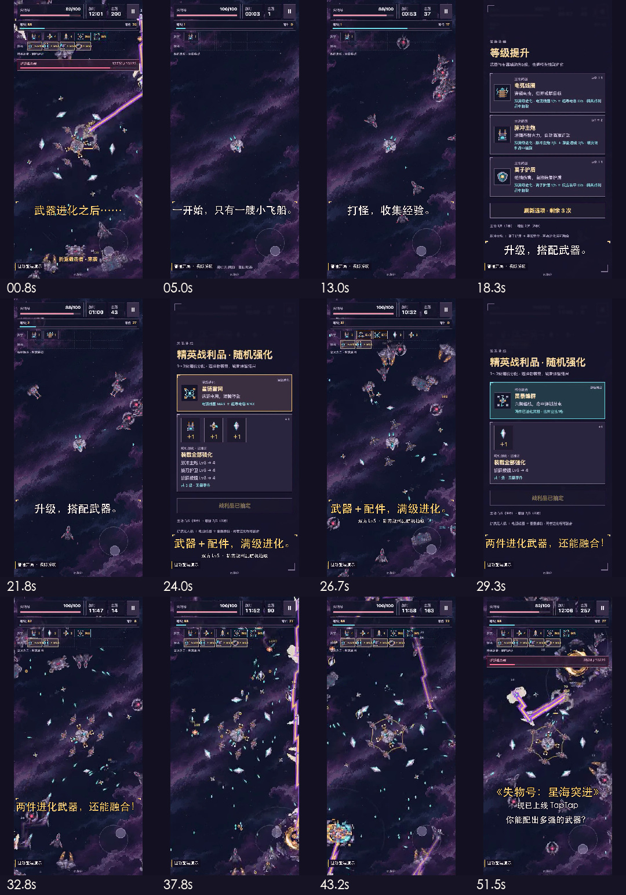

# 《失物号：星海突进》创作者宣传片 v1

本片围绕“一艘普通小飞船，后期武器进化融合后，会有多夸张？”制作。真实战斗、经验收集、实际选卡与后期精英战构成主体，短字幕随节拍弹出。

## 交付

| 文件 | 用途 |
| --- | --- |
| [final-portrait.mp4](final-portrait.mp4) | 54.000秒成片，1080×1920，30fps，H.264 High 4.1／AAC 48kHz双声道，50,411,601字节 |
| [cover.jpg](cover.jpg) | 1080×1920封面，取自成片41.2秒对应的真实战斗底片 |
| [preview-contact-sheet.jpg](preview-contact-sheet.jpg) | 十二个关键时间点的成片预览 |
| [edit-plan.md](edit-plan.md) | 实际剪辑时间线、字幕与音频处理 |
| [sources.md](sources.md) | 原素材审看、本轮补录、版本与来源 |
| [source-footage/](source-footage/) | 七段带同步游戏音效的精选视频，以及项目原创合成配乐 |
| [render.sh](render.sh) | 可重复渲染入口 |
| [verification.json](verification.json) | 成片摘要、解码、画面、音频和运行文件保护检查 |
| [playback-verification.json](playback-verification.json) | Chromium／WebKit的真实HTTP播放结果 |



## 内容与来源

4～23秒取自180秒普通新局实操。开局只带基础主炮，第一张真实升级卡在原录制57.138秒出现，选中电弧线圈。其余段落使用合法的进阶配装检查点，通过普通玩家入口继续，保持真实敌人、伤害、移动和音效。片中分别标注“普通开局 · 实际游玩”和“进阶配装演示”。

34～54秒来自同一段20秒连续战斗，包含紫金雷网、蜂机、晶体、星环奇点和真实精英交战。48秒后战斗继续，叠加片名、TapTap提示与问题。

素材捕获源码为 `4ba48981fa2b63ed6e26ebc5f658a92cc643a9a5`。当前控制器已核验八条5＋5进化与四条双进化融合配方，高级卡受精英／Boss战利品和75%随机结果约束。字幕额外标注“双方 Lv5 · 精英战利品随机抽取”。十二组模型检查和真实选卡画面共同留证。

游戏完整画面保持原比例，使用深紫侧边填充形成9∶16画布。录制器空白边在素材导出时移除，完整390×844游戏视口保留。原25fps画面通过重复原帧输出30fps，游戏时间保持1倍。字幕使用本机系统黑体简体字体，最终固化为图像。

本轮提交集中在宣传目录。158份录制运行文件前后摘要一致，已有玩法、存档实现与发行包保持原始文件。对照见 [gameplay-parity.json](gameplay-parity.json)。

## 音乐

配乐使用本项目 `audio-engine.js` 中的原创合成主题，88BPM，按开局、成长、进化和高潮调整层次与响度。游戏音效来自同次画面的实际输出总线。两首用户MP3的清单将商业许可登记为待核实，本片选择原创主题编配。来源与算法见 [music-provenance.json](music-provenance.json)。

实际综合响度为−18.35 LUFS，真实峰值−1.39 dBTP。AAC解码峰值0.825，满幅削波采样0。完整测量见 [audio-verification.json](audio-verification.json)。

## 实际检查

| 检查 | 结果 |
| --- | --- |
| 50～55秒、1080×1920、H.264／AAC、30fps | 通过，54秒／1620帧 |
| 全片视频与音轨解码 | 通过 |
| 黑屏、录制器灰边、画面边界 | 扫描通过，十二处关键帧复核 |
| 原HUD与主角可见性 | HUD差值取样通过，字幕位于主角下方，选卡时下移至空区 |
| 进化、融合与来源标签 | 十二组当前控制器模型检查及实际选卡复核通过 |
| 34～54秒连续实操 | 原录制3.164～23.164秒，真实时钟与正常损伤 |
| Chromium／WebKit，360×800与390×844 | 四组真实HTTP播放、32次实际帧定位及AAC音轨分析通过，两引擎另各完整播放54秒 |
| 字幕与关键画面内部目视 | 十二格总览、原尺寸选卡帧和手机尺寸播放帧已复核 |
| 用户视觉、节奏和听感 | 待审 |
| 实体手机、TapTap创作者端转码后效果 | 待测 |

首轮检查发现录制器灰色填充和选卡字幕重叠，两处均已返修。初始宽松冻结检测将低密度星空移动识别为静止，57帧局部复查显示57个不同解码帧及可见移动像素，最终检测以−70dB／0.5秒运行，三处静止均对应正常选卡。HTTP测试采用现有支持Range的服务，补上音频同源导航与实际呈现帧等待，最终截图与定位时间对应。

## 播放与复现

Mac可直接打开本目录MP4。

```bash
open artifacts/taptap-promo-v1/final-portrait.mp4
```

在仓库根目录渲染，使用现有FFmpeg／FFprobe、Python Pillow 9.5.0与NumPy 2.0.2。

```bash
sh artifacts/taptap-promo-v1/render.sh
python3 artifacts/taptap-promo-v1/verify.py
node artifacts/taptap-promo-v1/verify_mechanics.cjs
```

Mac字体路径默认为 `/System/Library/Fonts/STHeiti Medium.ttc` 的简体字面。其他环境可通过 `PROMO_FONT` 和 `PROMO_FONT_INDEX` 指定本机可用的中文字库。

真实浏览器检查需要先启动素材HTTP服务，再执行播放脚本。

```bash
node prototypes/salvage-survivor-demo/serve.cjs --root artifacts/taptap-promo-v1 --port 4473
node artifacts/taptap-promo-v1/verify_playback.cjs --continuous
```

补录使用独立4472端口与全新浏览器上下文，步骤见 [sources.md](sources.md)。原始180／14／22／45秒录制与完整输入轨迹保留在本机 `releases/taptap-promo-v1-private/`。仓库中的精选片段可直接重复生成本片。

## 发布建议

建议标题为“一艘小飞船，武器进化后能有多夸张？”。正文可用“拖动走位，自动开火。武器与配件双满级，再试试双进化融合。来配一套你的火力路线。”，关联游戏页面 https://www.taptap.cn/app/1022667 。

发布前由用户确认手机上的字幕阅读、配乐与武器音效比例、封面选帧。当前游戏页面可打开App试玩，页面说明与本片机制已核对。创作者账号发布由用户审片后执行。
