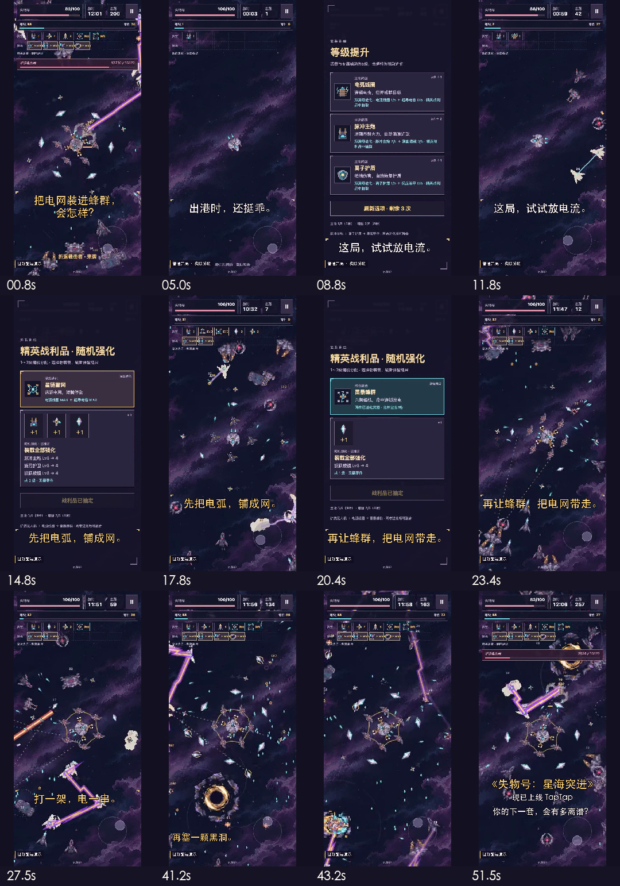

# 《失物号：星海突进》创作者宣传片 v2

这版以“把电网装进蜂群，会怎样？”作为钩子。普通开局保留4秒，接着展示电弧织网、蜂群融合、追踪放电，再用星环奇点与精英交战进入高潮。

音乐重写为原创电子配乐《Relay Chase》，144 BPM，加入四拍底鼓、八分低音、十六分踩镲和合成器旋律。融合实际确认附近的22秒设落拍，后半段持续推进。游戏音效使用同期录制，强音效出现时配乐轻微让位。

| 调整 | v1 | v2 |
| --- | --- | --- |
| 主钩子 | 武器进化之后 | 电网装进蜂群会怎样 |
| 普通开局镜头 | 8秒 | 4秒 |
| 文案焦点 | 收经验、升级、搭配 | 电网和蜂群如何组合，组合后实际打出什么效果 |
| 文字例子 | 打怪，收集经验 | 打一架，电一串 |
| 音乐 | 88 BPM项目回退主题 | 144 BPM新写电子配乐，融合落拍与持续鼓组 |
| 封面 | 武器进化之后 | 会追踪的电网？ |

## 交付

- [final-portrait.mp4](final-portrait.mp4) 为54秒竖屏成片，1080×1920、H.264／AAC、30fps。
- [cover.jpg](cover.jpg) 取自实际战斗49.2秒对应底片。
- [preview-contact-sheet.jpg](preview-contact-sheet.jpg) 展示十二个实际成片时间点。
- [edit-plan.md](edit-plan.md) 记录时间线和字幕。
- [sources.md](sources.md) 与 [sources.json](sources.json) 记录画面来源、取用区间和摘要。
- [compose_music.py](compose_music.py) 与 [music-provenance.json](music-provenance.json) 保存原创配乐的完整制作方法。
- [verification.json](verification.json) 与 [playback-verification.json](playback-verification.json) 保存本版实际检查。



## 来源与检查边界

4～14秒来自普通新局。其余画面通过合法进阶配装检查点，在普通玩家控制器中继续实际战斗。来源标签随镜头切换。34～54秒继续采用完整20秒实操，保留移动、伤害、精英、弹幕与掉落。原25fps录像按1倍时间重复原帧到30fps。

运行源码为 `4ba48981fa2b63ed6e26ebc5f658a92cc643a9a5`，父版素材提交为 `9e8271ed3ea1f231ee0e1559a6f8d0ef9ad8e600`。原始采集、八条双满级进化和四条双进化融合检查见父版 [完整来源](../taptap-promo-v1/sources.md) 与 [模型记录](../taptap-promo-v1/mechanics-verification.json)。本版增加取用融合原录制5.5～14.5秒，重点呈现蜂机追踪放电的实际过程。

本版专项验证包括整片解码、黑屏与停帧扫描、十二处HUD取样、音频电平和完整运行资源摘要。浏览器按Chromium／WebKit及360×800／390×844执行实际HTTP播放、音轨检测和32次呈现帧定位。用户对吸引力、音乐和字幕的审核，以及实体手机和TapTap创作者转码后的表现继续待审。

本次实测4组浏览器／尺寸组合通过；两引擎各完整播放54秒成片，墙钟耗时分别54.463秒与54.457秒。Chromium记录到3次`waiting`事件（含起播），WebKit为0次。成片完整解码通过，未检出黑屏；检测到的三处停帧均对应实际选卡画面。AAC解码后无满幅削波样本，综合响度−16.16 LUFS，真峰值−1.83 dBTP。最终文件57,937,166字节，SHA256为`e0d3ef75a7d577c976fb8782dc34f0f3be040f6b5e7b945781f2926d31c8c99b`。这些检查验证文件与播放技术，音乐感受和吸引力仍由用户审核。

## 复现

仓库根目录执行，画面输入引用已提交的v1精选片段与本目录新增片段。

```bash
python3 artifacts/taptap-promo-v2/compose_music.py
sh artifacts/taptap-promo-v2/render.sh
python3 artifacts/taptap-promo-v2/verify.py
```

使用现有FFmpeg／FFprobe、Python Pillow与NumPy。Mac字体沿用系统黑体简体字面。`PROMO_FONT` 与 `PROMO_FONT_INDEX` 可指定其他本机中文字库。

浏览器检查使用现有支持Range的HTTP服务。

```bash
node prototypes/salvage-survivor-demo/serve.cjs --root artifacts/taptap-promo-v2 --port 4473
node artifacts/taptap-promo-v2/verify_playback.cjs --continuous
```

## 发布建议

建议标题为“把电网装进蜂群，会怎样？”。正文可用“原本只会点射的小飞船，装出了一群会追踪放电的蜂机。还能顺手塞一颗黑洞。来试试你的下一套配装。”，关联游戏 https://www.taptap.cn/app/1022667 。
