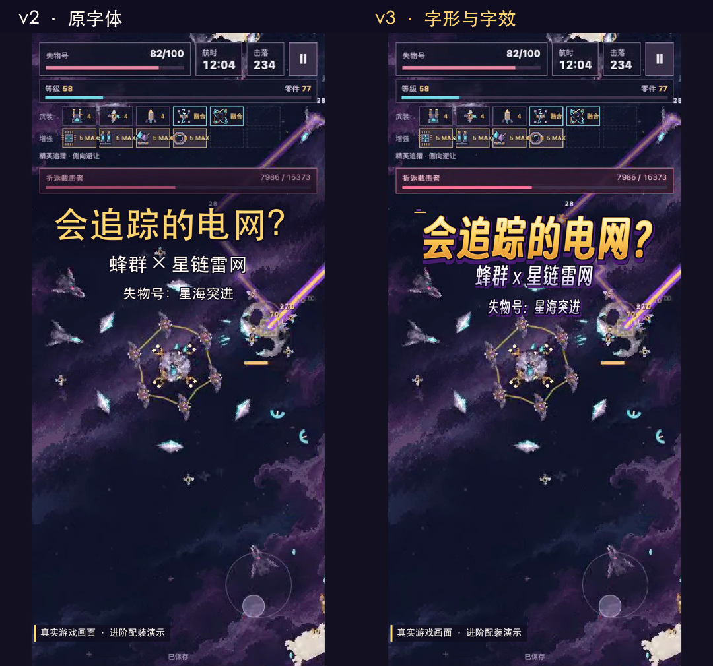

# 创作者宣传片 v3 · 字体精修

基于已交付v2的54秒剪辑，更新封面、开场钩子、短字幕和片尾游戏字标。标题采用前倾粗斜字形、暖金字面和紫色侧影，字幕沿用同一字形并减轻装饰；来源标记与TapTap信息保持简洁。真实游戏HUD沿用录像原字。

- `final-portrait.mp4`：1080×1920／30fps／H.264＋AAC，54秒。
- `cover.jpg`：同一实际战斗帧上的新标题，保留飞船和完整HUD。
- `typography-before-after.jpg`：v2与v3封面同帧对照。
- `preview-contact-sheet.jpg`：十二个实际成片关键时间点。
- [可复用字标与规范](../../design/star-salvage/promo-typography/README.md)：原始字体、OFL许可、透明字标与字效脚本。



## 来源与边界

时间线、字幕内容、实际镜头与144 BPM配乐继续使用v2。此版将v2最终AAC流直接复制进新视频，以便声音保持相同。4～14秒普通开局，其余为合法进阶配装演示；34～54秒完整连续实操，均以1倍速度。完整来源见[父版来源](../taptap-promo-v2/sources.md)与[实际采集记录](../taptap-promo-v1/recording-evidence.json)。

本次没有补录战斗，没有改动游戏代码、平衡、存档、发行包或线上资料。v1与v2保留。

## 重建

```bash
sh artifacts/taptap-promo-v3/render.sh
python3 artifacts/taptap-promo-v3/verify.py
```

仓库原有FFmpeg／FFprobe、Python Pillow、NumPy及本机系统黑体继续使用。标题字库随源文件和许可入库。脚本从已提交的v1／v2精选片段重建底片，不依赖私有原录制；中间文件存放在忽略的`releases/taptap-promo-v3-private/`。

浏览器回归：

```bash
node prototypes/salvage-survivor-demo/serve.cjs --root artifacts/taptap-promo-v3 --port 4474
node artifacts/taptap-promo-v3/verify_playback.cjs --continuous
```

实际结果见`verification.json`、`typography-verification.json`、`playback-verification.json`。工程播放、内部抽帧、用户美术与手机审核分别记录；用户对字体气质、吸引力和平台转码的验收待审。

本版实测4组Chromium／WebKit×360×800／390×844播放通过，32次呈现帧定位无媒体错误；两引擎完整播放分别耗时54.054秒与54.458秒。Chromium仅起播记录1次`waiting`，WebKit为0。整片解码、黑屏扫描、12处HUD抽样、8组字幕边界和字库缺字检查通过。音轨AAC逐字节与v2一致，综合响度−16.16 LUFS、真峰值−1.83 dBTP。158项原运行资源摘要相等。

最终视频54.000秒，57,996,874字节；SHA256为`3c91051784380dd22c0fa1fd2d4732a24fa163eddd63982969a0a24da83f9bf8`。封面顶部500像素与实际底片平均差0.891（JPEG压缩量级），新增遮罩和字形均位于HUD下方。内部抽帧已复核封面、开场、选卡长字幕、黑洞和片尾，真实手机及用户视觉验收仍待进行。
