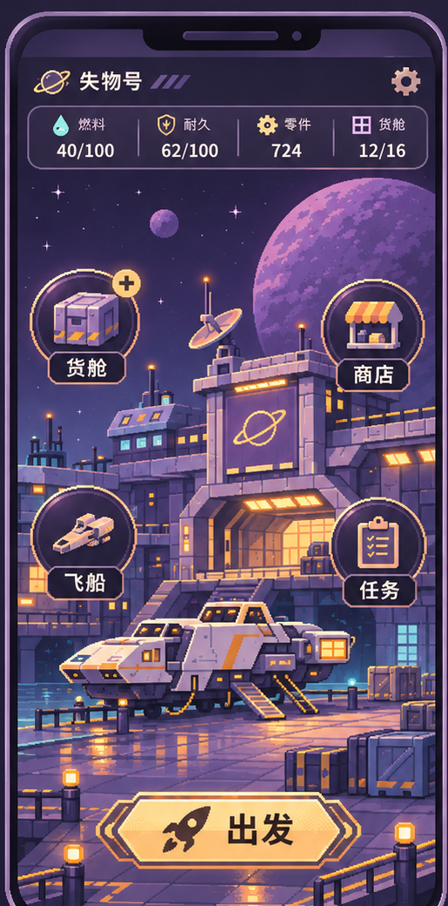
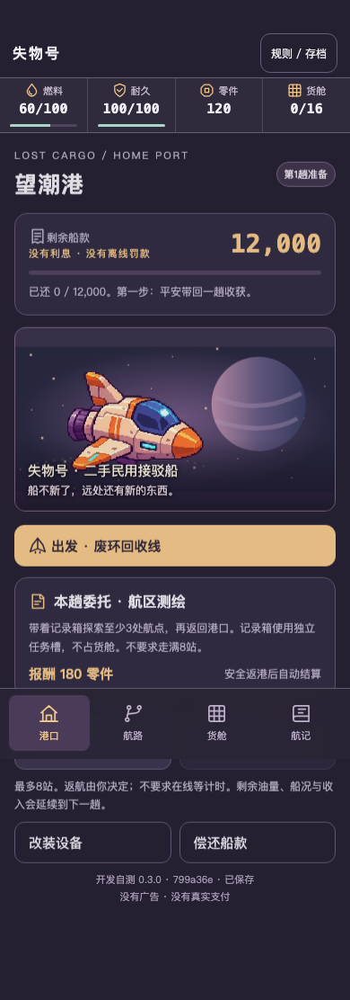
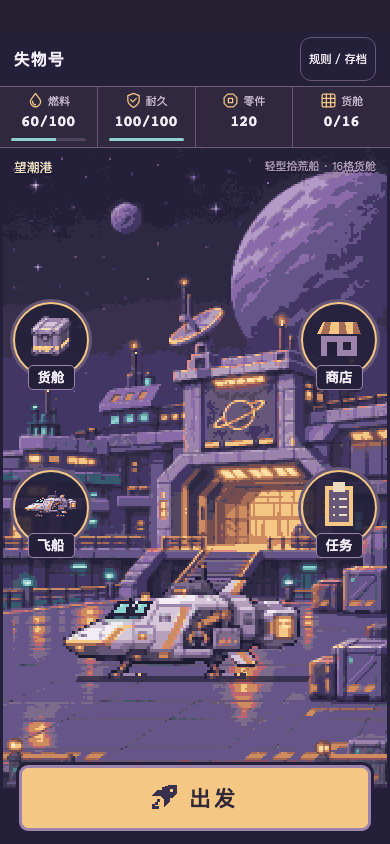
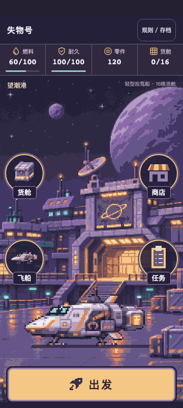
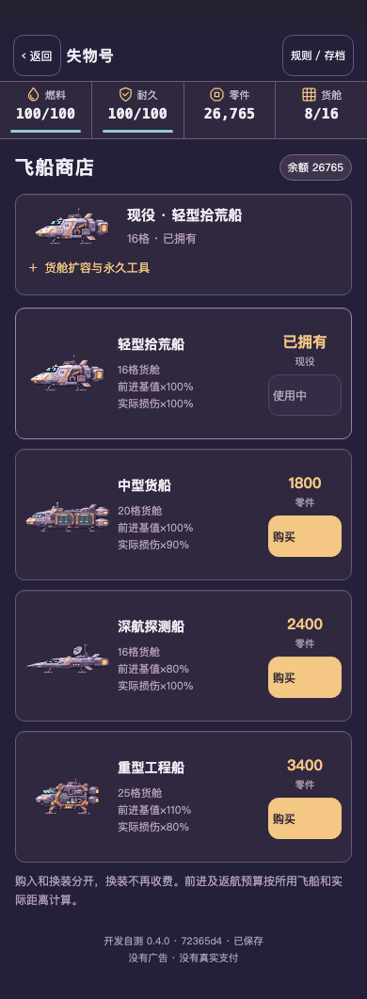
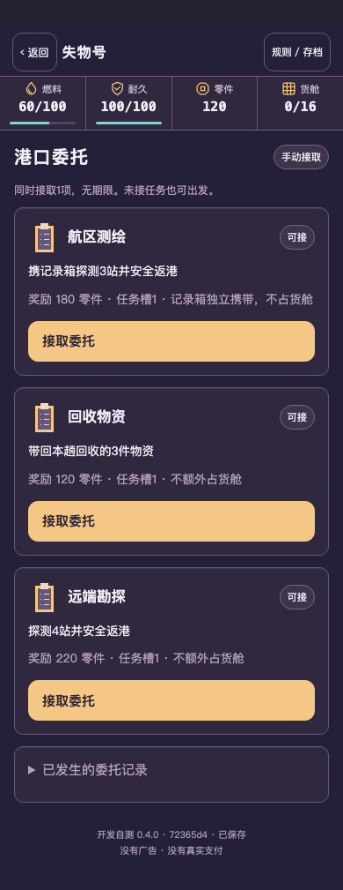
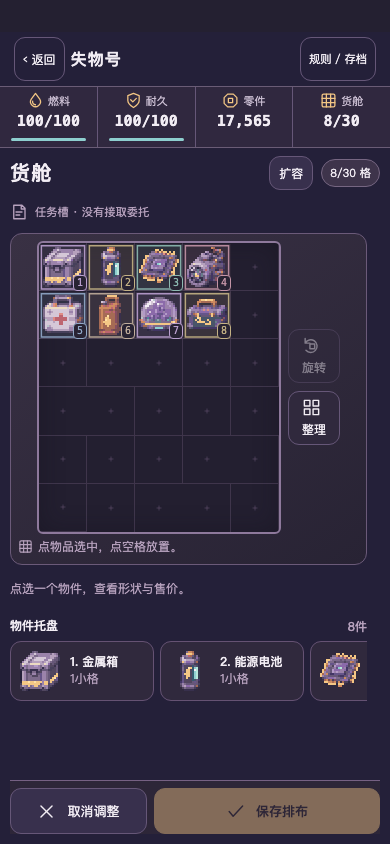
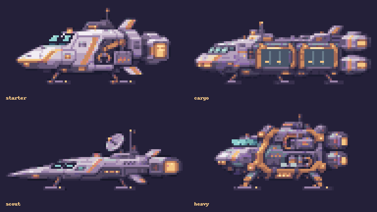
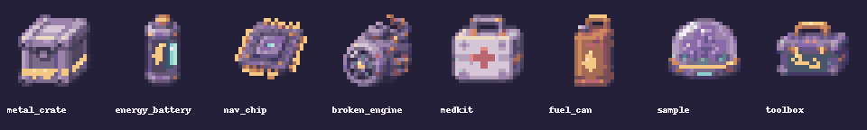
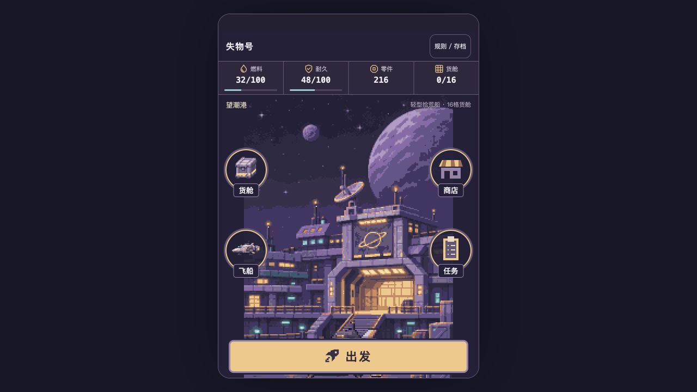

# 同包视觉复核：0.4.0 / 72365d4（待用户审核）

这不是第二套验收登记；逐项状态仍在唯一ASSET_REGISTRY。以下均为同一冻结包真实HTTP截图。素材制作先分配给三个美术子任务，主代理审查原生图与实际页面，保留可用素材；没有重画主游戏。

| 用户唯一参考 | 旧0.3真实运行 | 新0.4真实运行390×844 |
|---|---|---|
|  |  |  |

画风沿用统一紫灰港口、暖金灯光、工业船身与圆入口；独立船贴图3x，背景2x，脚线接地并有阴影，前景透明层保持航站空间。参考的文字、按钮、货币样例没有烘焙到背景；实际渲染HTML有可点击状态。偏差：中景机库体积更大、船在画面下方更居中，货舱/飞船入口采用正式sprite，商店/任务为原生像素glyph；UI文字保持可读字体。静态港口不宣称动态场景。是否符合用户期望仍需新包视觉审核。

独立图审曾指出船过小、舰店目录太长：已经放大到整数3x并把现役摘要与改装折叠，首屏可比较两款替代船；禁用按钮不再把价格一起压暗。短640屏阴影受底托覆盖2px已将完整场景上移8px，未单独悬空抬船。历史UNFROZEN图审在production/port-internal-art-review，不能冒充本固定包结果；最终下图与浏览器矩阵才绑定72365d4。

| HOME360×800 | 真实购船页 | 手动任务板 | 8种货物和真实扩容 |
|---|---|---|---|
|  |  |  |  |

购船/满货图为显式导入27049 QA档，单独录像，不假装新手自然买齐。物件图与格子掩码分离，每件只画一次。四船原生与八物原生总览：

自然连续录像（没有导入、改种子、改时钟）：[第一趟](../../../artifacts/salvage-port-v04/developer/capture/natural-voyage-1.mp4) / [第二趟](../../../artifacts/salvage-port-v04/developer/capture/natural-voyage-2.mp4)。单独[QA购船、装备、扩容和一键补给](../../../artifacts/salvage-port-v04/developer/capture/qa-buy-equip-expand-supply.mp4)。原始WebM并存，MP4仅转码、未剪接为伪连续。完整13自然/4QA存档检查点保存在同包capture-report，回归与费用不靠截图推断。

固定包0.4为129840字节，旧0.3为81658字节，增48182字节；新资产14张PNG，原图/ORA/4x/生成候选不入H5。真实性能见[局部HTTP比较](../../../artifacts/salvage-port-v04/developer/performance-comparison.json)：每引擎/版本3个新上下文，包含实际源码SHA和load时间。它是本机局部HTTP结果，不代表手机帧率、蜂窝加载或WebView功耗。

真实Mac原来源的更新截图（用户存档未花费、未重开）与[逐项迁移核验](../../../artifacts/salvage-port-v04/delivery/local-browser-check.json)：

内部图审通过不等于用户签收。真实手机、锁屏、操作手感与趣味均仍待审。
