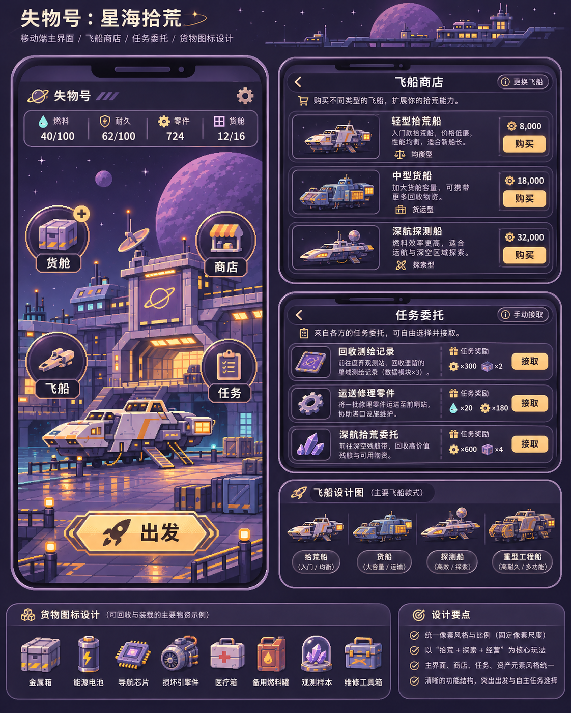
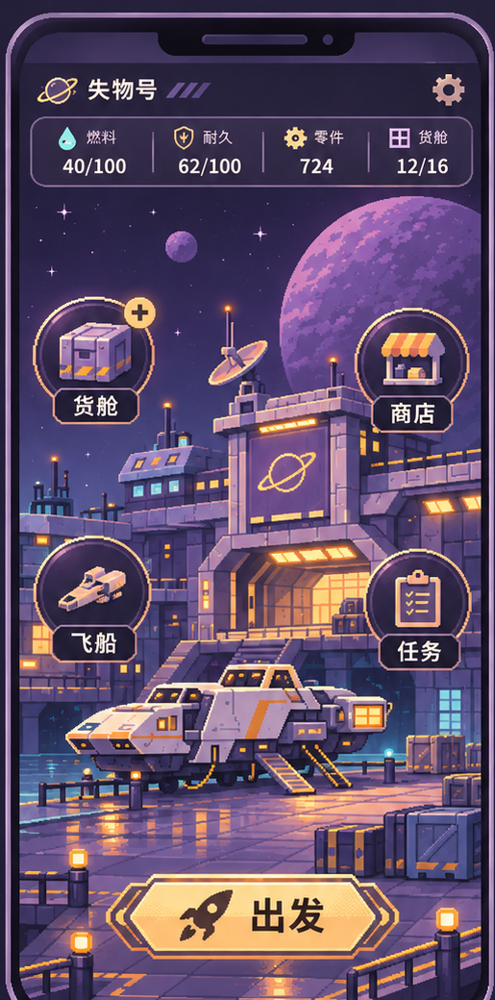
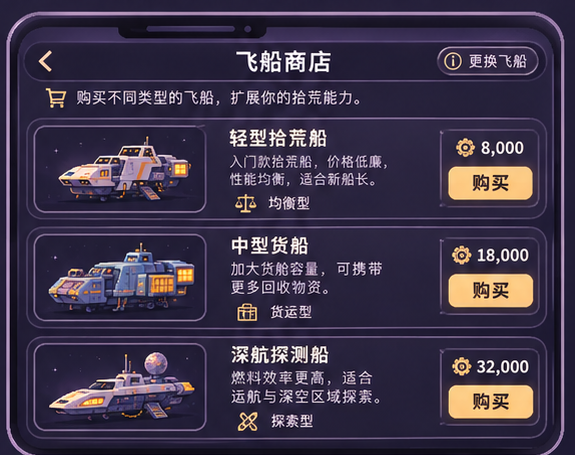
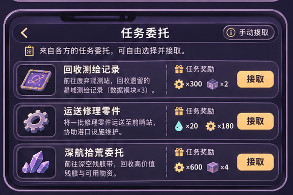
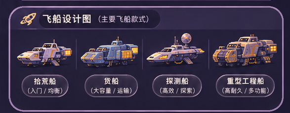
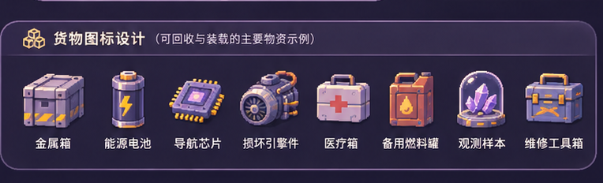

# v0.4 用户认可视觉源图与构图分区（原字节入库）

**这张完整主视觉是当前唯一获用户认可的风格参照。** 使用原生像素手法重新绘制可运行背景、飞船、货物；**下面的截图裁片并非透明sprite、生产素材或已实现游戏UI**。本轮不保留第二套港口首页，不靠长网页或固定四Tab操作。

## 唯一主视觉（1122×1402）

**源字节核验：** PNG 2,142,727 bytes；SHA256 `16289e481145f9c781d5ecf353de0f00861fb17fbc3df2185d94e77b978cacb0`；Git blob `c101690bd726f303cb7244d81baf954637466cb8`。

## 参考分区（只帮助 Codex 理解细节）

| 港口主界面 | 飞船商店 |
|---|---|
|  |  |

| 任务委托 | 不同飞船 |
|---|---|
|  |  |

| 具象货物图标 |
|---|
|  |

[上一版风格参照（旧，不能替换这一版）](./salvage_v04_style_predecessor.png)

## 落地规则

- 港口背景逻辑192×320原生像素，2×、4×整数倍导出；独立 ship sprite 96×48原生像素；item sprite 24×24原生像素；同尺度、同光照、同调色板。
- 主界面的文字、资源数值、悬浮按钮、出发按钮由 HTML/CSS/本地SVG 独立真实渲染，**不能烘焙进背景图**。
- 飞船必须按真实 `equippedShipId` 切换外观；任务必须玩家主动接取；资源补满和购买真实结算；物件外观图与1～8格几何mask相互独立。
- 概念图上展示的售价、任务奖励、容量和选项文字只是画面示例，**不构成已审核的游戏数值或任务逻辑**。

[视觉和系统规格](../PORT_UI_VISUAL_AND_SYSTEM_SPEC.md) · [素材要求清单](../ASSET_REQUIREMENTS.json) · [Codex任务书](../../../../codex/SALVAGE_V04_PORT_UI_IMPLEMENTATION_TASK.md)
