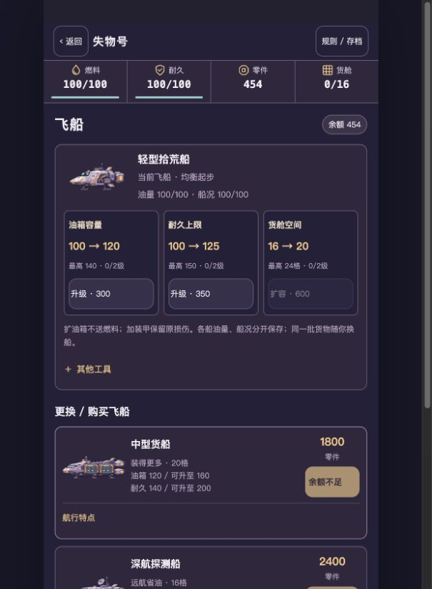

# 0.4.1 开发自测交付 · 待用户画风与手机审核

试玩：[原Mac入口](http://127.0.0.1:4283/loststar-salvage/)。TapTap开发自测 **458136**，运行源码 **754113a197e52762a80de5e33a45192074f2a99b**。它是独立Demo，不绑定正式主包、不提审、不发布；Draft PR #2保留。

| 用户反馈 | 本轮实际实现 | 固定包证据 |
|---|---|---|
| 船型特点难懂 | 角色定位、容量、可选具体航行例子；删除前进基值／损伤百分比术语 | 飞船截图、当前双引擎升级检查 |
| 看不到船本体升级 | 当前船首屏三张油箱／耐久／货舱卡；有限等级和实际扣费；基础船同样可升 | QA工程升级连续录像、17项模型、并发与失败写盘 |
| 各船上限应不同 | 四船有各自基础／最终上限、费用、升级次数；资源条／店铺／事件／用品同源 | 参数表、cap-aware补给截图与模型 |
| 现场记录默认打开 | 完整正文直接显示，不重复第一句 | 自然首趟事件截图和录像 |
| 货物外形应等于占格 | 保留长条、L、T；每件一张完整实体，切口透明，旋转与保存同步 | 同物件旧新版对照、13轮廓×4旋转、全部16shape实际入口解码 |
| 商店／任务图标不统一 | 同一37色与原生像素尺度的立体PNG | HOME、原生PNG／ORA／2x／4x |

## 包与存档

`artifacts/salvage-ship-v041/loststar-salvage-754113a.zip`：**195637字节、45文件**，SHA256 **3321ddb5ae3f04ac0f84678842bc7999dffba12f948ae74d5d6ea5692abd4969**。29张运行PNG，原1x／ORA／4x不装进H5。真实解包HTTP和Mac45份响应逐字节等于ZIP。

平台回读458136、文件名、精确195637字节、竖屏、未发布；正式主包前后相同。平台未提供ZIP摘要，不能把本地SHA说成平台重算值。[平台回执](../../../artifacts/salvage-ship-v041/taptap-receipt.json)。

实际原浏览器UI导出前／后／再刷新，完整等于冻结模型schema5→6迁移：454零件、11500船款、100燃料、100耐久、第四趟、已完成待领委托均保留；没有导入QA或执行交易。完整原档仅私有留本机；公开证明只有摘要与哈希。[本机核对](../../../artifacts/salvage-ship-v041/delivery/local-browser-check.json)。

0.4原包与[4292回退](http://127.0.0.1:4292/loststar-salvage/)、0.3的4289、0.2的4287和0.1的4284保留。回退浏览器仍须显式使用相应版本私有备份，不能让旧引擎覆盖schema6；回退服务不等于反向迁移。

## 验证结果

- 模型126项：保留原109项，加17项容量／升级／停泊资源／迁移。覆盖实际扣费、补给、事件、用品、在途锁定、旧权益和重复输入。
- 当前冻结包：Chromium／WebKit×360×800／390×844共108项，零跳过、零重试、零错误；另8组18px、合成44／24安全区、键盘及刷新检查。原0.4固定包另72项历史回归。
- 29项美术源导出验证：旧14项和新15项；新13个整体轮廓×4旋转，非占格透明、每占格至少70%实体覆盖、单个连通体、统一调色、整数nearest、ORA合成相同。
- 1008趟真实付费经济模拟，含已有全部旧购权益且余额27049的隔离旧档。参数和结果见[README](README.md)及[完整开发报告](../../../artifacts/salvage-ship-v041/developer/port-economy.json)，不在玩家入口展示事件表或最优解。
- 新档自然两趟连续录像，分别22.32／22.76秒，无导入、固定随机或改时间。两段独立27049 QA分别19.40／17.88秒，明确标记，不能当成普通玩家自然进度。
- 未改主游戏代码／素材，主游戏68文件、442项及构建本机通过。CI以对应提交的真实GitHub运行状态为准，不能套用上一版本结果。

## 画面与录像

同390×844、同显式QA货物UID／形状／位置／资金：[旧货舱](../../../artifacts/salvage-ship-v041/developer/comparison/before-cargo.png) → [新货舱](../../../artifacts/salvage-ship-v041/developer/comparison/after-cargo.png)；[旧飞船页](../../../artifacts/salvage-ship-v041/developer/comparison/before-fleet.png) → [新飞船页](../../../artifacts/salvage-ship-v041/developer/comparison/after-fleet.png)。仅页面改变，未拿不同货物数量掩盖占格。

- [自然第一趟／默认现场正文](../../../artifacts/salvage-ship-v041/developer/capture/natural-voyage-1.mp4)
- [自然第二趟／续玩](../../../artifacts/salvage-ship-v041/developer/capture/natural-voyage-2.mp4)
- [独立QA：购船／换船／扩容／补给](../../../artifacts/salvage-ship-v041/developer/capture/qa-buy-equip-expand-supply.mp4)
- [独立QA：真实升级／整体货物旋转／各船资源保留](../../../artifacts/salvage-ship-v041/developer/capture/qa-ship-upgrades-and-physical-cargo.mp4)

原始WebM与检查点同目录保留，MP4仅转码、无剪接或加速。HOME／商店／任务／货舱／飞船的360与390截图在`developer/capture/`。内部复核见[VISUAL_REVIEW.md](VISUAL_REVIEW.md)。

## 明确待审

真实TapTap手机WebView、真实刘海／系统字号、锁屏恢复、发热和触控手感未测；本轮15张新素材和玩法趣味尚未由用户签收。旧版本此前的手机通过不能转为本包通过。零件消费有限且可选，策略模拟不是实际玩家时长或最优解。仍不做第二颗星球、复杂战斗、新货币或正式发布。
