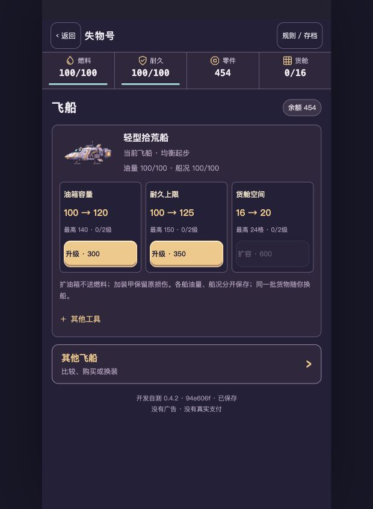

# 0.4.2 Review返修开发自测 · 用户／真机待审

用户Mac：[继续试玩](http://127.0.0.1:4283/loststar-salvage/)。TapTap开发自测 **458870**，运行源码 **94e606fc773d1dc37341d29923e39e7ec7c3863b**。原港口、四入口、价格、真实航路与全部旧档权益保留。

| Review建议 | 实际修改及固定包证据 |
|---|---|
| R1 可购／禁用态难区分 | [实际原档升级页](../../../artifacts/salvage-polish-v042/delivery/mac-fleet.jpg)：454余额，300／350金色可购，600灰色禁用；保留原价和确认。取消、资金不足与两标签不多扣 |
| R2 当前船与长列表分组 | 当前船三种升级首屏；“其他飞船”进入同一H5二级区域，[原档二级页](../../../artifacts/salvage-polish-v042/delivery/mac-shipyard.jpg)，返回当前船。买／换装保留真实价格、属性和独立资源，不增HOME入口 |
| R3 同形不同类别的货物 | 正常内容14组合实际接入，11张新增整件结构＋3张保留金属图；同为line2的5类别有不同外观，不在格内复制小箱子。原面积、旋转、UID和价值不变 |

## 对照与录像

以下均来自实际HTTP，不是概念图排版。同390×844、同454余额、同5件UID／形状／排布的显式QA：

| 页面 | 0.4.1旧包 | 0.4.2冻结包 |
|---|---|---|
| 当前船 | [原长页／灰色按钮](../../../artifacts/salvage-polish-v042/developer/comparison/before-fleet.png) | [高亮及二级入口](../../../artifacts/salvage-polish-v042/developer/comparison/after-fleet.png) |
| 同形货物 | [同轮廓共用图](../../../artifacts/salvage-polish-v042/developer/comparison/before-cargo.png) | [五种完整实体](../../../artifacts/salvage-polish-v042/developer/comparison/after-cargo.png) |
| HOME | [原港口](../../../artifacts/salvage-polish-v042/developer/comparison/before-home.png) | [保留构图和四入口](../../../artifacts/salvage-polish-v042/developer/comparison/after-home.png) |

- [8.40秒独立454 QA：升级确认／取消、二级列表、五种同形物、旋转保存及刷新](../../../artifacts/salvage-polish-v042/developer/capture/qa-review-polish.mp4)
- [21.04秒独立27049 QA：实际购船、换装、扩容和补给](../../../artifacts/salvage-polish-v042/developer/capture/qa-buy-equip-expand-supply.mp4)
- [17.72秒独立工程升级／整件旋转／资源保留](../../../artifacts/salvage-polish-v042/developer/capture/qa-ship-upgrades-and-physical-cargo.mp4)
- [22.28秒自然第一趟](../../../artifacts/salvage-polish-v042/developer/capture/natural-voyage-1.mp4) / [22.60秒自然第二趟](../../../artifacts/salvage-polish-v042/developer/capture/natural-voyage-2.mp4)

自然两趟没有导入、改随机或改时间，实际无强制等候。QA另起隔离上下文，不能冒充自然进度。原始WebM、完整检查点及两尺寸页面截图同目录保存，MP4只转码，无剪辑或加速。

## 工程、存档与包

- 当前冻结包Chromium／WebKit×360×800／390×844：**128项**，无跳过、重试、全局错误；另8组18px、合成安全区、键盘和续玩。原0.4.1冻结包另108项独立回归。
- 模型／几何／旧档／费用共131项（原126＋5项真实内容清单、同形类别、旧schema6与费用配置检查）；40项原生／ORA／导出校验，其中新增11项×4旋转44组：非占格透明、每占格至少70%实体、单连通、共享37色、精确整数导出。
- 重新执行1008趟实际付费模拟，报告与0.4.1**逐字节相同**：SHA256 `13d8742f4da762139e2c11567063f6a4261cead980ddf047aec813ba8f87d909`。没有借视觉返修调整费用或奖励。已有全部旧权益且余额27049的隔离副本也保留原结果。
- schema6不变，无需字段迁移。实际现有浏览器UI导出前／后／再刷新**全量相等**：454零件、11500船款、燃料100、耐久100、第四趟、待领委托、全部历史与设备未变；只查看了当前／其他船页面，没有交易或QA导入。完整备份只保存在本机私有目录，公开[核对报告](../../../artifacts/salvage-polish-v042/delivery/local-browser-check.json)仅含摘要／哈希。
- 固定ZIP：`artifacts/salvage-polish-v042/loststar-salvage-94e606f.zip`，**235633字节／57文件**，SHA256 **a067f3cc5431792e42642ff881f0602910c21f282f81e6772a02ae22d772b652**。实际解包HTTP与Mac57个响应逐字节一致。
- 平台回读458870、文件名、精确大小、竖屏与未发布；正式主包前后相同。[回执](../../../artifacts/salvage-polish-v042/taptap-receipt.json)。平台不提供ZIP摘要，不能将本地哈希称为平台重算。
- [0.4.1回退4295](http://127.0.0.1:4295/loststar-salvage/)、0.4的4292、0.3的4289及更早包／备份保留。未操作其他游戏命名空间。唯一登记在原251项上追加7项，不删除旧条款或证据。

初次预检遇到此前QA服务已退出，启动真实HTTP后重跑；预演中无改动保存及冲突旋转被程序正确阻止，修正录制动作后重新完整录制。未靠测试重试或跳过掩盖问题。CI以本次提交的真实工作流为准，不能套用上一包。

## 美术与性能边界

11项原图、原生源、ORA、2x／4x、内置生图提示词与加工记录见[素材目录](README.md)，内部图审见[VISUAL_REVIEW.md](VISUAL_REVIEW.md)。原29项素材没有覆盖，三张合适金属图复用。

包195637→235633字节，增加39996；运行PNG118176→155079字节。单次本机导航样本只留作开发对照：它不是全部PNG就绪时刻、交互就绪或FPS，不能证明手机性能提升。[原始性能样本](../../../artifacts/salvage-polish-v042/developer/performance-comparison.json)。

真实TapTap手机触控／安全区、锁屏、长期发热、11项新增美术和收集惊喜仍待用户验收。旧任意导入组合继续用原封存包装，不声称做完104种跨组合皮肤；正常事件／商店14组合已全覆盖。继续Draft，不合并、不绑定正式主包、不提审、不正式发布，不开发第二颗星球。
