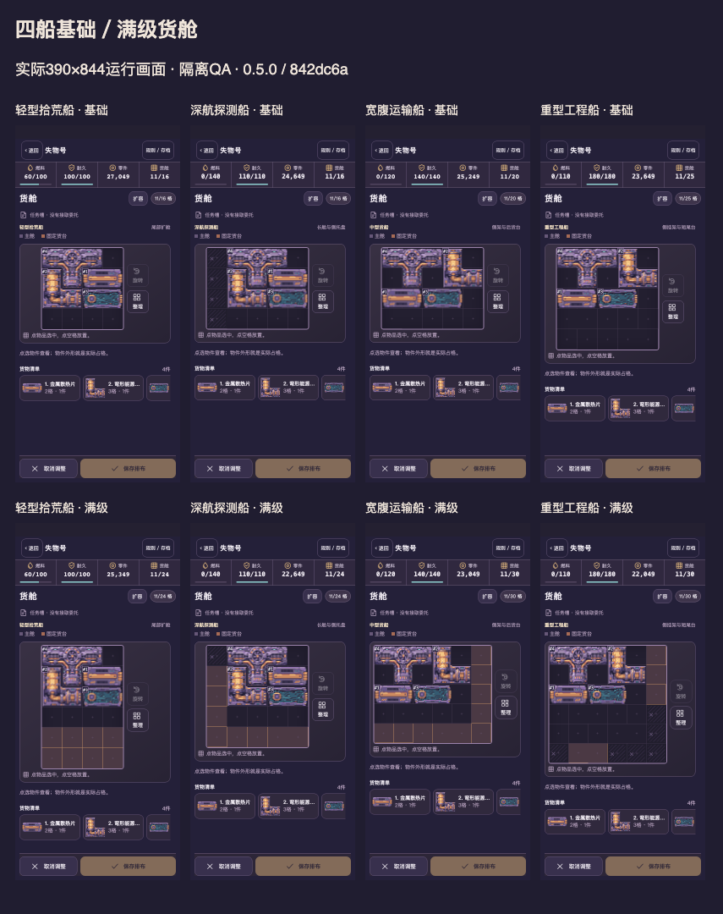

# v0.5 开发自测交付 · 待用户与真机验收

## 试玩

[Mac原试玩入口](http://127.0.0.1:4283/loststar-salvage/) 已更新，原标签页刷新后指向 `842dc6a`。该地址供这台Mac使用。手机使用下方TapTap开发自测码。

TapTap开发自测 **465523**，运行 **0.5.0**。

选航点，把收获装进货舱，留够返航油再回港出售；黑市可自行选择。

## 版本绑定

| 项目 | 实际值 |
|---|---|
| 运行源码 | `842dc6afcfc3da079c40dc996a4dd346769d62e0` |
| 包 | `loststar-salvage-842dc6a.zip` |
| 大小 | 266,243字节 |
| SHA256 | `18aeba82a05221809f77a7ace3e8a58300b8fa42749caff5f7900698d7401c4a` |
| 文件／运行PNG | 67／44 |
| 平台回读 | 465523，竖屏，文件名及字节数相符，发布中为false |
| 正式主包 | 上传前后资料模块逐字段相同 |
| 证据 | `artifacts/salvage-v05/verification.json`，证据提交独立于源码提交 |
| 旧版回退 | 0.4.2 /94e606f /TapTap458870；Mac端口4297，原schema6私人导出保留 |

## 四船实际货舱

全部11档升级各有360×800、390×844真实画面及同货物旧版对照，货台容量、原费用与升级前后UID均核验。

[全部对照与连续录像](../../../artifacts/salvage-v05/developer/capture/index.html)

- [自然第一趟](../../../artifacts/salvage-v05/developer/capture/natural-voyage-1.mp4)
- [关闭重开后的第二趟](../../../artifacts/salvage-v05/developer/capture/natural-voyage-2.mp4)
- [隔离QA四船升级](../../../artifacts/salvage-v05/developer/capture/qa-four-ship-holds-and-real-upgrades.mp4)
- [隔离QA议价、快拍及刷新](../../../artifacts/salvage-v05/developer/capture/qa-black-market-offers-and-refresh.mp4)

自然录像没有导入、改种子或改时钟。QA录像使用显式副本。MP4只转编码，连续WebM原件保留。

## 实际验证

| 范围 | 结果 |
|---|---|
| Chromium／WebKit，360×800与390×844 | 固定ZIP176项通过，零跳过／重试／意外失败 |
| 大字、安全区、键盘、刷新 | 8项通过，合成44/24安全区 |
| 模型 | 原131组＋新增37组通过 |
| 几何 | 11档×120组；4×4旧大件、完整双格满载、L/T旋转、托盘、禁用格与单调升级通过 |
| 旧档 | schema2–6、满载、在途、原子备份、真实Mac旧档与27049余额副本通过 |
| 货物／市场 | UID、一次收费、流拍留货、取消、刷新、跨标签及写盘失败通过 |
| 经济 | 9216趟对照＋2560趟还款；512种子市场货物处置；旧成本与油耗相同 |
| 原生美术 | 44件1×／ORA／2×／4×；4新奇物16种物理旋转通过 |
| 包体 | 67个实际HTTP响应逐字节与ZIP相同；Mac替换后再次核验 |
| 自然游玩 | 新档两趟，刷新与关闭重开连续；13个存档检查点 |

真实Mac原档仍为454零件、11,500船款、100燃料、100耐久，原设备与待领任务保留。迁移后与冻结模型预期完全相同，再刷新导出相同。导出原文仅存本机私人目录，公开证据只记摘要和哈希。查看货舱后取消，未进行玩家消费或QA导入。

## 经济与性能

[完整经济、装载及数值依据](BALANCE_VALIDATION.md)

同组正常货物的整组装入成功数持平或提高。运输船25格107→112/120，探测船24格106→113/120，工程船30格116→116/120。部分大件组合仍不能放进新异形舱，旧档保留原矩形直到能够无损转换。

普通短途平均净现金159.13→183.16，含手动测绘339.13→363.16。探测船深途395.65→332.81，仍需试玩评估差异。市场费用与潜在流拍已计入净现金。

包体旧235,633→266,243字节，增加30,610字节。一次本机冷页面样本，图像就绪Chromium297.5→294.8ms，WebKit346→279ms。样本各一次，只提供观察值。未测真实手机帧率、内存、温度或耗电。

## 待审与未实施

- 用户对四船装载手感、新奇物画风、收入节奏和黑市趣味的审核。
- 真实TapTap手机的触控、安全区、锁屏返回、长时间续玩及性能。
- 独立港口背景锐度微调未实施，当前沿用已认可0.4.2素材。
- 虫洞实际航行规则继续留在设计候选，当前普通返航费保持原模型。

PR #2继续Draft。本包为开发自测。
