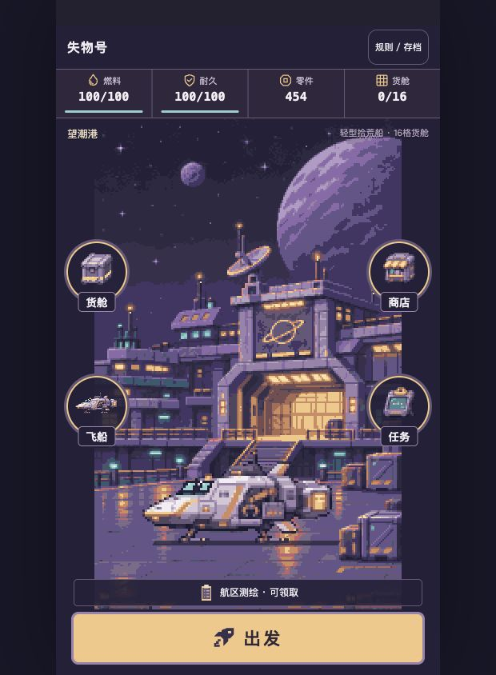

# 0.5.1 开发自测交付 · 待用户与手机审核

[打开Mac原入口](http://127.0.0.1:4283/loststar-salvage/) · TapTap **469033** · 版本 **0.5.1**。

选航点，把收获带回港口，卖货和补给由你决定。

## 固定运行包

- 运行源码066a657945b45756a05ea350a1ca5c42972dc371。
- artifacts/salvage-v051-final/loststar-salvage-066a657.zip，共271,754字节、68文件、44 PNG。
- ZIP SHA256 e7a7529aad0a42efd19f84dbec98400f6d987e33ee82e55039f0b9909862e0c5。
- 本机与隔离HTTP逐文件等于ZIP；ZIP逐文件等于固定源码构建。
- TapTap回读文件名、精确大小271,754、竖屏1、is_releasing=false。平台未提供远端文件摘要，所列SHA256为本地已上传ZIP的摘要。
- 正式主包模块前后相等，未绑定主包、提审或正式发布。PR #2继续Draft。

## 实际本机续玩

已刷新原用户IAB tab1至066a657路径，schema7原子迁移至8。原454零件、11,500船款、第四趟、空货舱、舰队与待领委托保留。导出后逐项等于冻结引擎restore结果，再次刷新完全相等。只读导出和重载，没有替玩家出航、消费、领取或导入QA。

0.5.0/465523可用[4304回退入口](http://127.0.0.1:4304/loststar-salvage/)，0.4.2/458870可用[4297回退入口](http://127.0.0.1:4297/loststar-salvage/)。各旧ZIP、平台包与私有原档保留，不把新schema8存档导入旧引擎。

## 验证

181模型组，当前固定包240项Chromium/WebKit×360/390用例、8项兼容、44美术资产校验通过。624安全航次、512保底航次、9旧在途快照、11,520经济拆因、5,120市场批次、2,592含市场航次、2,560还款航次均可复跑。3趟自然连续实录与显式QA分别标注。旧0.5的176项及所有历史固定包证明单独保留。

完整原始报告、视频、图片、平台回执及实际用户档哈希由verification.json绑定。私有完整用户存档只在Mac私有备份目录保存，不入库。

## 待审核

真实TapTap手机的触控、系统安全区、锁屏/后台恢复、长时间发热待用户复测。用户美术与趣味待审。旧schema7在途这一趟沿旧返航规则，UI会提示下一趟启用信标；没有重抽正在玩的事件。全12个新奇遇已见的玩家不会获得伪造的“新发现”。

## 最终冻结补查

首个候选349cc33/468993已经保留在artifacts/salvage-v051，随后独立核查发现110%拍卖底价按钮存在浮点取整显示偏差。最终066a657/469033修正为与引擎、确认框一致的整数百分比，原价格和实际账本不改。最终包重新通过240浏览器、24实际市场点击轨迹、8兼容与181模型组，并重录3趟自然航行。请使用本页469033二维码。
