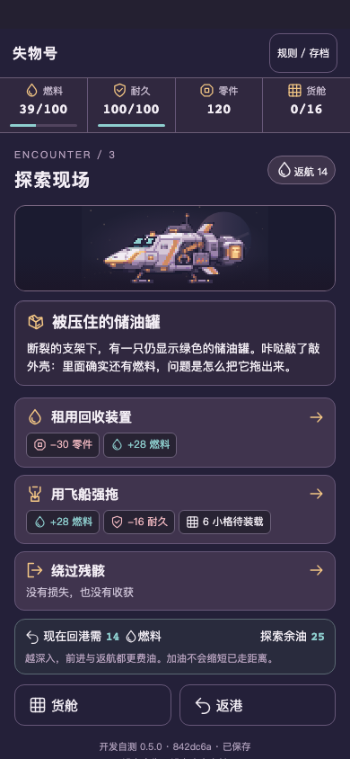
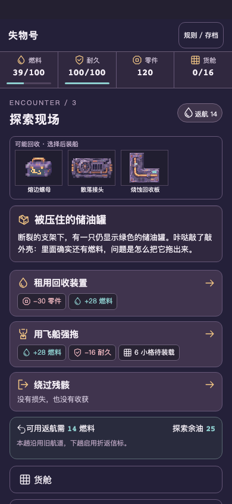
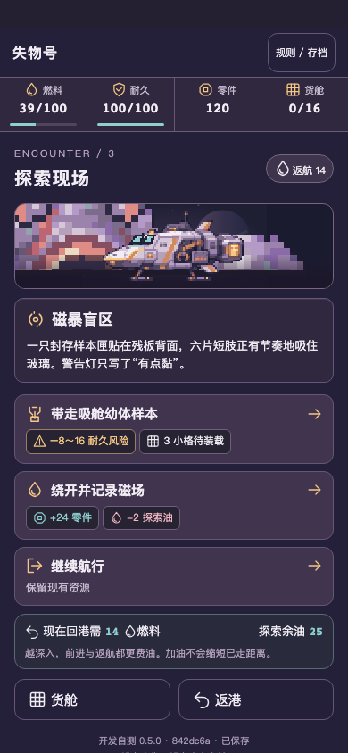
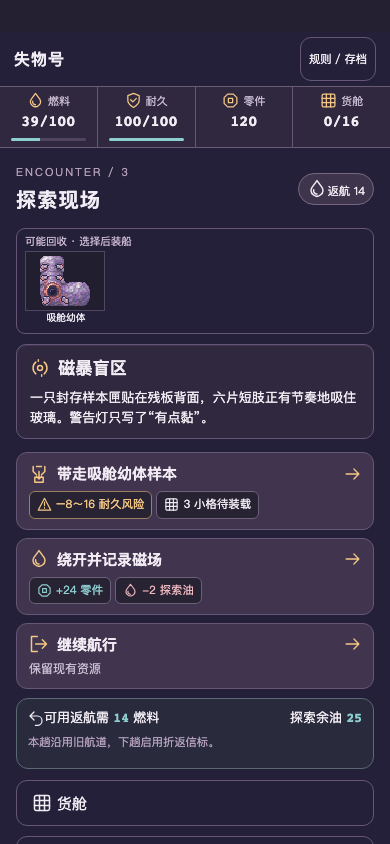
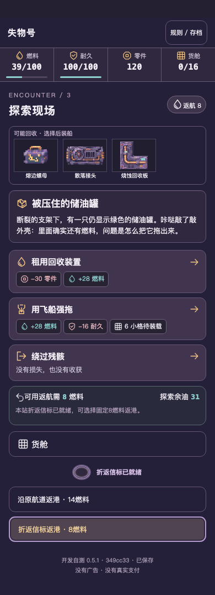
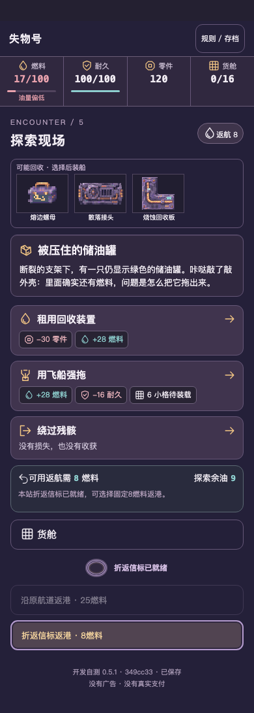
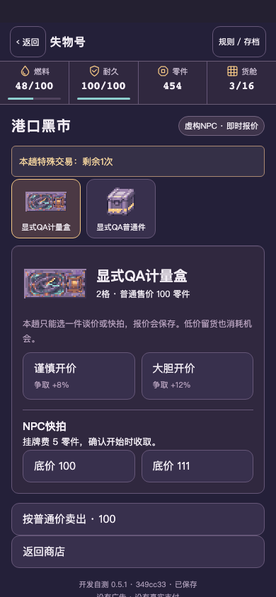
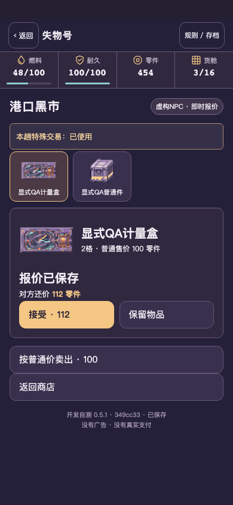

# 0.5.1 实际画面复核

固定349cc33包在真实HTTP运行。下图均为390×844浏览器视口，部分纵向完整截图超过844高。普通1/2/3格与4/8格、四件奇物在四项目中另有逐项浏览器边界和遮挡测试。没有重做港口、飞船、货形或概念图。

## 普通回收物

| 旧0.5.0 | 新0.5.1 |
|---|---|
|  |  |

## 奇物完整图

| 旧0.5.0 | 新0.5.1 |
|---|---|
|  |  |

物品独立成紧凑可能回收物栏，完整PNG contain，旋转后的整体仍在父框内。结果栏只标实际获得UID。实际检查包含decode、宽高、object-fit、z-index、父框交集和elementFromPoint遮挡检测。

## 真实报价与机会变化 · 隔离QA

| 第3站普通/折返 | 第5站普通/折返 |
|---|---|
|  |  |

| 归航后1次 | 报价后已用 |
|---|---|
|  |  |

## 连续实录与复核边界

自然实录使用crypto新档，未导入、改种子、改时钟，3趟均实际航行/处理/返航/卖货/补给，关页重开继续。5次新发现、2次异常实际可见，普通选项仍可自由选择。自动操作速度较快，原始录像保留，支持暂停细看；不宣称为真人阅读节奏。

- [自然第1趟](../../../artifacts/salvage-v051/developer/capture/natural-voyage-1.mp4)
- [自然第2趟](../../../artifacts/salvage-v051/developer/capture/natural-voyage-2.mp4)
- [自然第3趟](../../../artifacts/salvage-v051/developer/capture/natural-voyage-3.mp4)
- [显式QA两处门与实际扣油](../../../artifacts/salvage-v051/developer/capture/qa-gate-three-five-and-receipts.mp4)
- [显式QA共享机会、拒价、换货与刷新](../../../artifacts/salvage-v051/developer/capture/qa-market-shared-chance-and-refresh.mp4)

5段原始WebM及同尺寸、无剪辑、无倍速MP4均保存。capture-report.json保留实际状态、tapTrace与图片计算值，media-info.json记录时长和尺寸。内部实际画面已核对，手机裁切/触控与用户视觉验收仍待审。
