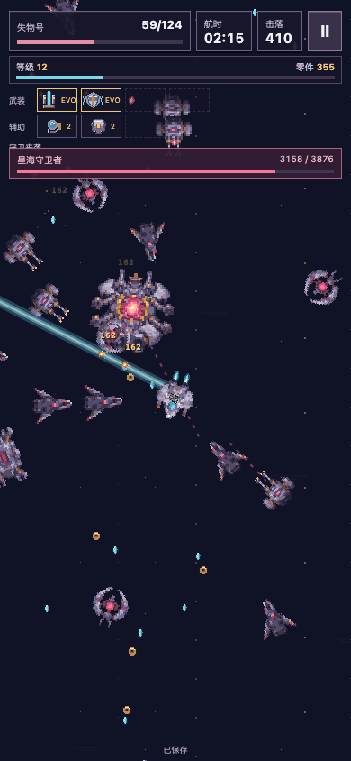
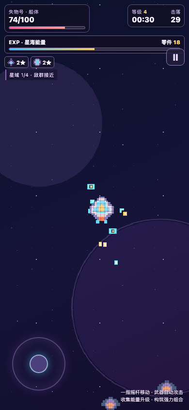
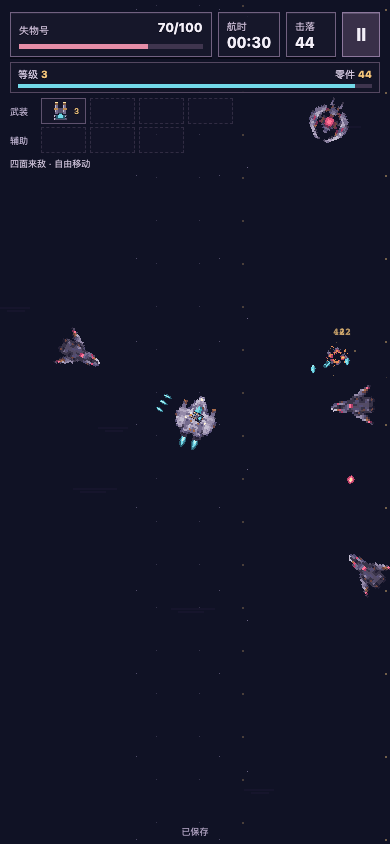
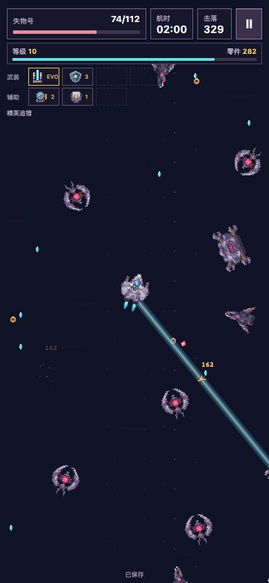
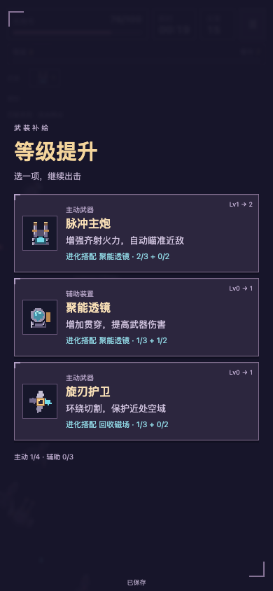

# v0.6 独立试玩交付，待手机与视觉审核

**TapTap开发自测469298 · v0.6.0 / 04ad5a8**。

按住画面拖动飞船，武器自动开火，拾取晶体后选择强化。

用户最新授权直接依据PR的紫灰、暖金、冰蓝像素科幻描述继续美化。三手机概念板未取得，新增素材未宣称为该原图的分层导出。

## 可访问入口与冻结包

- Mac直接打开 `http://127.0.0.1:4397/`。
- 用户最新明确要求直接上传TapTap扫码，已完成469298开发自测回读。手机验证使用该二维码。4397留作工程复核。
- 运行源码 **04ad5a8b908f5bfcfec7173d0b5a7cd8d010fe19**。
- 包 `artifacts/survivor-v06/current/loststar-survivor-04ad5a8.zip`，**61,130字节，46文件，39 PNG**，无外部运行依赖。
- ZIP SHA256 **00f64b45db8f62414b488e50030c318cb46978e1a84e54046b2ec4e0bb4aed5b**。
- 解包HTTP46文件逐项等于ZIP；源文件逐项等于固定源码，普通入口无QA操作对象。

TapTap上传包 `loststar-survivor-04ad5a8-taptap.zip` 为62,786字节。平台要求单一游戏目录，因此仅给冻结包增加 `loststar-survivor/` 外层，46个运行文件逐字节不变。上传包SHA256为 `621e84790956ea7a90213f0c1588040eb99a97216e55919e9ec1bff1a6905c5e`。平台回读文件名、大小、竖屏及未发布状态，正式主包模块前后完全相等。平台未返回远端ZIP摘要。

## 逐项执行

| 编号 | 要求与实际入口 | 本轮实现／证据 | 剩余验收 |
|---|---|---|---|
| S06-01 | 4397启动与原型基线 | 固定包HTTP、Mac实际页面、源文件和运行资产摘要 | 用户试玩 |
| S06-02 | 一指360°、镜头与四面来敌 | 浮动摇杆、键盘、自动攻击、碰撞、拾取、单指取消与输入释放 | 物理手机触控 |
| S06-03 | 六进化、两融合、普通联动 | 实际攻击／护盾／释放槽断言，8武器连续靶场 | 用户组合爽感 |
| S06-04 | 飞船／敌人／Boss／武器美化 | 7角色、20图标、9组件、3帧图集，1×PNG与ORA、2×/4× | 用户美术 |
| S06-05 | 简明UI与完整短局 | 开始、4主动／3被动、三选一、180秒截止、结算、两项强化、再来 | 手机安全区与手指遮挡 |
| S06-06 | 独立存档 | IDB事务、版本冲突、失败重试、同一随机快照、结果只结一次 | 物理手机锁屏 |
| S06-07 | 自然节奏、经济与性能 | 两趟无QA连续输入、96策略、双引擎30秒压力测量 | 真人二刷意愿与移动端发热 |
| S06-08 | 实际Safari | 原生Safari应用移动、选卡、暂停、刷新继续、切后台、结算 | iOS Safari与TapTap WebView |
| S06-09 | 原档与回退 | 原用户档UI导出与上一交付逐字段完全相等，schema8、454零件／11,500船款／第4趟保留 | 主入口替换后再次核对 |
| S06-10 | 4283与TapTap | 新TapTap469298已上传并核验，066a657／469033回退保留 | 4283待手机反馈后切换 |

唯一要求登记保留之前307项，新增10项SALVAGE06要求，分别记录实现、证据、内部视觉、用户与真机状态。原章／星球／航路的历史证据没有被新模式结果覆盖。

## 实际连续录像与画面对照

- [两趟自然连续试玩](../../../artifacts/survivor-v06/current/natural-two-runs.mp4)。全程正常入口，使用键盘和实际可见卡片，随机种子与时间不覆盖。第二局实际花70零件买船体Lv1。
- [八武器QA靶场](../../../artifacts/survivor-v06/current/qa-eight-weapons.mp4)。显式合法配方、独立QA命名空间、高血量靶，展示全部6进化与2融合，不能当自然成长速度证据。
- [原型基线连续记录](../../../artifacts/survivor-v06/baseline/natural-baseline.mp4)。原始cd9559b原型，作为节奏与视觉比较。
- [内部美术复核](ART_REVIEW.md)，记录暗敌轮廓和彗星弹幕图标的返修。连续录像保留原始时间，MP4仅做编码转换。

| 原型实际30秒 | 本版实际30秒 |
|---|---|
|  |  |

| 本版自然进化后 | 本版实际升级卡 |
|---|---|
|  |  |

## 固定包验证

- 冻结网页包与实际TapTap单目录包分别通过**108项** Chromium/WebKit × 360×800/390×844，零失败、零跳过、零重试。涵盖6进化、2融合、4联动、浏览器触控仿真、视口安全区注入、暂停、后台、180秒截止、刷新、重复输入、两窗口、存储失败与旧命名空间隔离。
- **15组实际模型断言**、39项美术与1×/2×/4×映射、96条策略模拟通过。模型适配器单独标注，持久化使用真实浏览器IDB验证。
- Chromium与WebKit关闭整个持久浏览器进程后重开，原记录完全相等，继续对局和下一局通过。
- macOS Safari **26.5.2**实际应用通过启动、四向移动、自动击杀、三选一、选卡、暂停、刷新继续、切换标签后台暂停与结算。实际版本以 `current/safari.json` 为准，未将WebKit仿真标为手机Safari。
- 30秒显式压力场保留40敌、48危险弹、140拾取、128粒子，28伤害字、20电弧／圈、24爆炸上限。Chromium帧间隔P95约16.8ms，WebKit约19ms。机器与并发负载写入原始JSON。**这些是桌面测量，手机帧率与发热未测。**
- 两趟自然连续输入首升级19.96秒／28.63秒，存活161.79秒／135.45秒，分别585／417击落，均形成进化并遇到Boss，均未击退Boss。完整96策略、收费保持与候选调整见 [经济报告](BALANCE_REPORT.md)。
- 原用户档仅只读导出至Mac私有目录，未导入QA或提交Repo。当前导出与上一v0.5.1交付的实际最终导出完全相等。
- CI首轮因Linux Python导入缓存被打包门禁识别为未提交文件而失败，已加入缓存排除与具体路径诊断，修复后重新跑，原失败记录保留。

## 当前门禁

**手机触控／实际安全区／系统缩放／锁屏恢复、TapTap WebView、用户视觉和趣味待验收。**

用户本轮明确要求直接上传TapTap，取代先用局域网验证再上传的步骤。**新开发自测469298已交二维码**，手机结果尚未回传。原4283主试玩继续保留v0.5.1，待这次手机反馈后切换。旧平台469033、旧包、源代码、私有旧档与已购四船权益继续保留，新模式没有将其硬折算。

PR #2保持Draft。CI最终回执与证据提交链接更新在同一PR。本页交付为可运行、可保存的独立开发试玩，整体视觉、趣味与真机没有最终签收。
