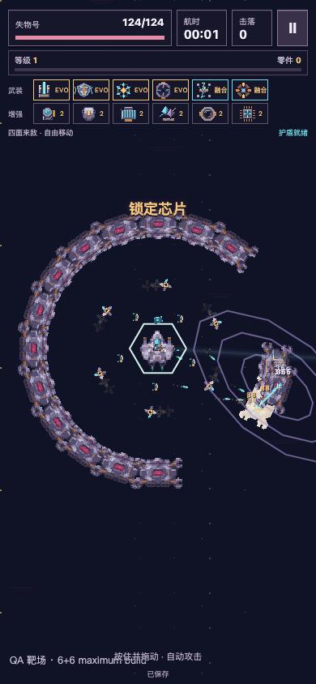

# v0.6.1 开发自测，待用户实机与趣味审核

**TapTap469347 · v0.6.1 / 55610d6**。

按住拖动飞船，武器自动开火，拾取晶体后选一项强化。暂停里可分别调整音乐与音效。

## 本次内容

用户提出10或15分钟与扩槽，本版选择**10分钟、6主动／6增强**。保留原六类武器，增加折跃棱镜、引力锚及对应增强、两条进化与星环奇点融合。总计8主动、8增强、8进化、3融合。中后段继续出现实际精英与Boss，合成会释放一个槽位。

Nebula Groove与Nebula Loop两首用户认可MP3已真实入库，原始文件逐字节保留。运行版合计4,624,124字节，流式交替循环，2秒交叉淡化。8类武器、拾取、命中、受伤、升级、进化、融合、Boss和结算有独立声音。首次点击解锁，授权失败不阻塞开局，暂停和后台停止，选卡时音乐压低，音量与静音独立保存。

原39项原创像素素材保留，新增7图标及4组6帧特效。1×PNG与ORA、2×／4×输出、原始生成图与提示、返修对照均在production目录。真实喷口、分束目标、引力中心和旋刃轨迹对应实际武器行为。

## 固定包与入口

- 运行源码 `55610d6d1370dd0b63e08610bb2df8fb7fa56f9f`。
- 网页ZIP `artifacts/survivor-v061/current/loststar-survivor-55610d6.zip`，4,693,809字节、60文件、50 PNG、2 MP3。SHA256 `a7b5ee367013944108572926b85cb544f5b66675525574d09bca06bda80c536a`。
- TapTapZIP增加单一外目录，60文件逐字节相同。`loststar-survivor-55610d6-taptap.zip`，4,695,969字节。SHA256 `a1b1447daef2c9733aeafc5d3f190676cf16e1a02ab1b32eab81326db79ea2b4`。
- 平台回读469347、文件名、大小、竖屏、未发布状态。主包模块前后完全相同，开发自测没有绑定正式主包。平台没有返回远端ZIP摘要。
- Mac原入口 [4283](http://127.0.0.1:4283/loststar-salvage/)已更新并跳转同源生存首页。独立工程入口 [4397](http://127.0.0.1:4397/)为相同冻结包。
- 同源旧玩法回退 [legacy-v051](http://127.0.0.1:4283/legacy-v051/)仍可读取用户原档。独立旧服务4399、066a657／TapTap469033、旧ZIP和v0.6.0／TapTap469298保留。

## 工程与存档

- 网页冻结包与实际TapTap单目录包分别通过144项HTTP测试，共288项。Chromium／WebKit × 360×800／390×844，零跳过、零重试、零失败。
- 21组实际模型断言、50项原生美术映射、160条实际策略模拟、32项双引擎音频验证。输入、三选一、真实进化／融合、升级原价、结算防重、故障重试、跨窗口冲突、暂停和旧键隔离分别覆盖。
- 旧v0.6.0在途快照保留180秒／4+3，下一局才使用600秒／6+6。27,049零件测试旧档的余额和满强化等级不变。原星球、剧情、航路键与备份没有被新模式读取或改写。
- Chromium／WebKit实际关闭整个持久浏览器进程再打开，原快照完全相等，继续本局、结算和再次开局通过。
- 原用户旧航路档从实际Mac页面导出，入口替换前后逐字段相等，原始导出SHA256均为 `9e0ac1c7095f688e38e64a850f2eb982baee7661e4f3dd3452864b7f653df4ac`。私有原档留在Mac，未导入QA或上传GitHub。
- 原生macOS Safari26.5.2已实际核对版本、新局、6+6、移动击杀、音量／静音刷新记忆、继续快照，以及切标签后暂停。浏览器显示播放音频指示。主观手机听感单独待审。
- 30秒显式6+6满配压力场同时运行真实武器、音乐、音效和自动保存。Chromium帧间隔P95为16.7ms，WebKit18ms。上一v0.6约16.8／19ms，测试时间与并发负载不同，该比较仅作桌面参考。没有声称手机帧率、发热或内存通过。
- CI以Draft PR #2当前提交的实际checks与完成回执为准。原v0.6固定证据校验继续运行，新v0.6.1证据单独绑定。

## 普通入口实际结果

一次600秒真实时间对局存活完成，4772击落、19级、带回805零件，主炮／棱镜／护盾三条进化并击退Boss。随后实际再开一局，暂停、刷新、继续的同一记录完全相等。音乐完成3次淡化切换，零播放失败。

自动规避策略首升级52.13秒，模型首升级中位18.60／21.23秒。自然输入保留此偏差，没有用模型时间替代自然录像。首分钟真人体验仍需核对。

## 连续证据

- [普通入口整局与下一局刷新继续](../../../artifacts/survivor-v061/current/natural-ten-minute-ui-silent.mp4)。实时键盘移动、实际可见卡片，保留尝试，无QA、时间或随机种子覆盖。全页面录像无音轨。
- [11配方与6+6满配实际混音录像](../../../artifacts/survivor-v061/current/qa-eleven-weapons-with-mix.mp4)。画面带QA标识，高血量靶和合法前置直接配置，录制实际Canvas与最终音乐／音效总线，无麦克风，不含HTML控件层。
- [原始自然记录](../../../artifacts/survivor-v061/current/natural-report.json)、[模型与经济](BALANCE_REPORT.md)、[内部音画复核与候选卖点](ART_AND_SOUND_REVIEW.md)。自然与QA证据分别标示。

## 仍待审核

用户已确认TapTap469298的核心玩法正常，并认可两首原始音乐。新版469347的十分钟节奏、新特效与最终混音仍待TapTap真机反馈。机型与系统未提供，物理锁屏、来电、长期发热、耗电、系统静音与扬声器平衡未宣称通过。

模型中beam优先路线强于其他路线，贪融合的void前期风险偏高。长局收益相对原960零件整备总价偏高，整备会较快升满。原收费与余额保留，未扩张新的消费系统。这些是明确的数值待审项。

Draft PR #2继续保留。开发自测、工程验证和内部复核分开记录，本轮没有整体美术或趣味最终签收。
