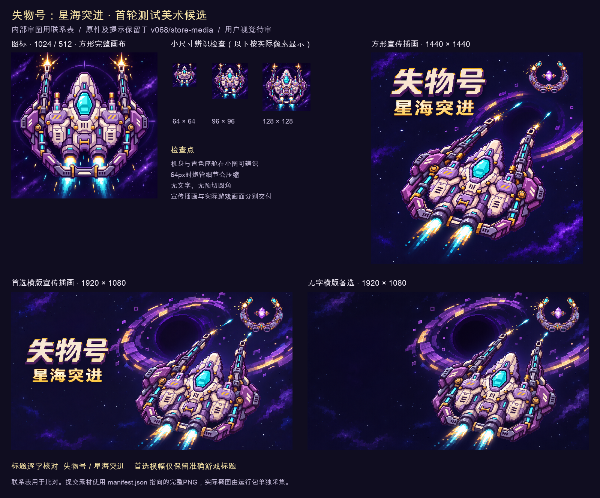

# 《失物号：星海突进》测试美术资料

本轮沿用已入库的紫灰白金飞船、青色座舱、双轨炮和深空星环画风。逐张检查1024与512图标、有字与无字横图、1440方图后，保留原组。仅为平台横幅准备一张去除玩法短句、保留准确标题的派生图。用户视觉审核待进行。

## 可审核总览



联系表为技术缩略排版。标准PNG使用下表中的独立文件，原图片完整保留。

| 用途 | 文件 | 实际尺寸 | 字节数 | 本轮判断 |
| --- | --- | --- | --- | --- |
| 游戏图标 | [1024图标](../../../v068/store-media/exports/taptap-icon-1024.png) | 1024×1024 | 1,216,774 | 首选，方形无字、轮廓完整 |
| 图标小尺寸 | [512图标](../../../v068/store-media/exports/taptap-icon-512.png) | 512×512 | 375,441 | 保留同源标准小尺寸 |
| 平台横幅 | [仅标题横图](exports/taptap-banner-title-only-1920x1080.png) | 1920×1080 | 2,088,056 | 首选，准确标题与飞船分区清楚 |
| 无字横幅备选 | [无字横图](../../../v068/store-media/exports/taptap-keyvisual-no-text-1920x1080.png) | 1920×1080 | 2,033,021 | 保留，适于平台自行排字的场景 |
| 方形宣传图 | [1440方图](../../../v068/store-media/exports/taptap-square-promo-1440.png) | 1440×1440 | 2,185,005 | 保留，标题和主体未裁切 |
| 原版介绍配图 | [含玩法短句的旧横图](../../../v068/store-media/exports/taptap-keyvisual-1920x1080.png) | 1920×1080 | 2,097,705 | 原件保留，首选平台横幅改用仅标题版 |

## 实际文件位置

工作目录为 `/Users/shuhuayu/loststar-game`。旧合格图片保持原路径，避免新增重复原件。

- `/Users/shuhuayu/loststar-game/design/star-salvage/v068/store-media/exports/taptap-icon-1024.png`
- `/Users/shuhuayu/loststar-game/design/star-salvage/v068/store-media/exports/taptap-icon-512.png`
- `/Users/shuhuayu/loststar-game/design/star-salvage/v0610/test-materials/art/exports/taptap-banner-title-only-1920x1080.png`
- `/Users/shuhuayu/loststar-game/design/star-salvage/v068/store-media/exports/taptap-keyvisual-no-text-1920x1080.png`
- `/Users/shuhuayu/loststar-game/design/star-salvage/v068/store-media/exports/taptap-square-promo-1440.png`
- `/Users/shuhuayu/loststar-game/design/star-salvage/v068/store-media/exports/taptap-keyvisual-1920x1080.png`

## 内部逐项审图

| 检查 | 结论 | 实际取舍 |
| --- | --- | --- |
| 游戏身份 | 紫灰白金机身、青色座舱、双轨炮、月牙Boss与已实现素材相连 | 沿用原组，保留现有辨识度 |
| 游戏名 | 横图和方图逐字为“失物号”“星海突进” | 组合名称为《失物号：星海突进》，运行模式可继续叫“星海生存” |
| 图标轮廓 | 1024和512均方形完整，双炮和尾焰上下连续 | 保留原画布与方角 |
| 小尺寸 | 64、96、128像素实际缩略中，青色座舱和中央船体可辨 | 64像素炮管内部细节较密，联系表如实保留 |
| 横版层级 | 左侧标题、右下玩家、右上Boss与射击方向清楚 | 新派生仅移除下方玩法短句，保持飞船、Boss和星环关系 |
| 方版融合 | 同一组主体、材质、光源、紫金星环与青色炮火 | 方图为既有完整构图，标题及尾焰保留 |
| 实机对应 | 宣传插画的金属细度高于48像素运行时船体 | 实机截图和连续录像另从当前运行包采集，宣传图登记为插画 |
| 用户审核 | 当前完成内部图像检查 | 用户对图标、宣传吸引力与实机一致性的评价待测试 |

## 来源与技术处理

原组的四次内建生图原始输出、提示、来源和运行时身份映射已保存在 [v068原始记录](../../../v068/store-media/manifest.json)。本轮未重新生成整组角色和美术。

本轮仅标题横幅使用 `image_gen.imagegen` 编辑现有横图。准确提示和输入路径见 [提示记录](title-only-edit-prompt.txt)，返回的完整工具原件保存在 [生成原件](originals/title-only-banner-generated.png)。该原件实际为1672×941，技术输出用Pillow最近邻转换为1920×1080，完整画布保留。长宽比差约0.05%。原图尺寸、字节与SHA256见 [本轮清单](manifest.json)。

1024与512图标均由1254×1254完整工具原件缩小。1440方图由1254×1254原件转换，旧1920横图由1672×941原件转换。标准尺寸对应技术导出尺寸。1×运行时像素层、2×／4×精灵及动画继续使用各生产目录中的现有文件。

## 平台规格与可重复校验

2026-11-13通过只读CLI回读当前 `basic-info` 和 `assets-upload`，revision为1199309。公开尺寸及场景摘要见 [规格记录](platform-specs.json)。图标最低512方形，横幅最低1920×1080，方形宣传图最低1440方形。三类接受PNG/JPG，横图和方图上限4MB。

本轮选取6个独立PNG，其中5个为保留文件、1个为新增派生横图。六个均通过TapTap CLI本地图片技术校验，具体manifest为 `taptap-local-*.json`。另有18项可重复检查，覆盖原件SHA256、PNG解码、源提示路径、尺寸、比例、字节、技术导出逐字节重现、CLI结果对应及联系表。

```bash
python3 design/star-salvage/v0610/test-materials/art/prepare_review.py
python3 design/star-salvage/v0610/test-materials/art/verify.py
python3 design/star-salvage/v068/store-media/verify.py
```

当前本轮18项、原组28项通过。报告见 [本轮结果](verification.json)和 [原组结果](../../../v068/store-media/verification.json)。平台本地校验只检查技术规则及待人工内容，平台素材审核与用户画风审核仍待进行。

## 本轮范围

完成游戏图标、横方宣传插画、原件与提示保留、可审核联系表及本地规格核验。实际试玩截图、视频、简介及测试包在上级资料交付中登记。此美术整理未执行素材上传或游戏资料字段写入。
