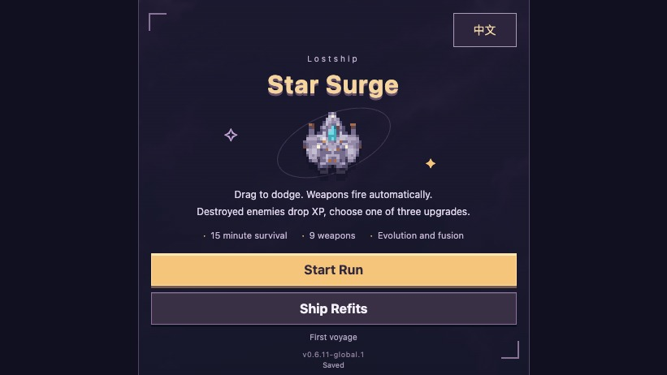
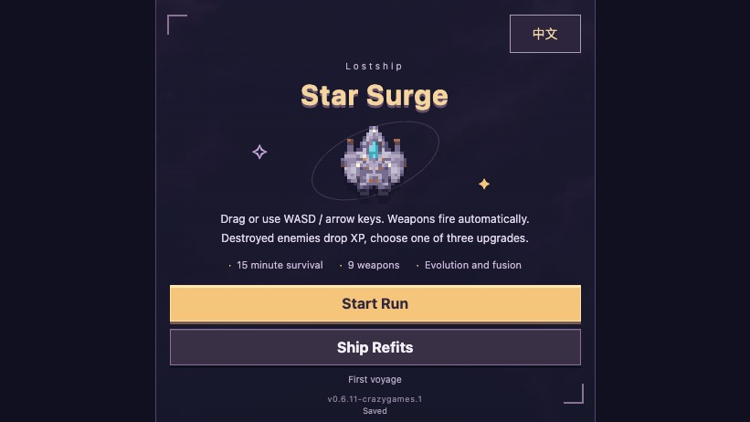

# Lostship: Star Surge · CrazyGames Basic Launch

CrazyGames 候选使用 0.6.11 国际版，默认英文，可切换中文。首页和首分钟提示加入桌面键盘操作，P 键和暂停按钮负责暂停，Esc 留给平台退出全屏。发行包禁用 QA 查询参数，并按平台要求关闭网页正文的触摸选取。首轮申请桌面端。

## 构建

```sh
python3 prototypes/salvage-survivor-demo/international/build.py --freeze \
  --output releases/crazygames-v0611/final/web \
  --crazygames-zip releases/crazygames-v0611/lostship-star-surge-crazygames.zip
unzip -tq releases/crazygames-v0611/lostship-star-surge-crazygames.zip
```

本次上传从冻结提交 `da82075448ef6c6683bd1aaab2be61400ebcf984` 构建。ZIP 根目录有 `index.html`，87 个文件共 5,390,771 字节。上传使用 ZIP 解压出的目录，CrazyGames 预览工具显示 5.1 MB，体积自动通过。实际 ZIP 的 SHA-256 为 `add034cd587cc5f12a27631684219c88a666149b8ad6129bf9c37e7a250a2fd5`。

存档由游戏内的 IndexedDB 管理。平台表单使用本地存档选项，跨设备同步尚未经验证。游戏无需登录，也没有外部广告。Basic Launch 可用无 SDK 构建。 [技术要求](https://docs.crazygames.com/requirements/technical/) · [自动存档说明](https://docs.crazygames.com/other/aps/)

## 验证

- 现有模型测试、素材检查和 20 项国际版语言测试通过。
- 从实际 ZIP 解包，使用两个不同站点的嵌套测试环境验证。Chrome 的 821×462、907×510、1216×684 和 1920×1080，Edge 的 907×510，以及桌面 WebKit 的 907×510 和 390×844，均通过开局、键盘移动、暂停、续玩、刷新后读取存档和 QA 参数禁用检查。Chrome 本机从导航至进入战斗为 0.47–0.59 秒，Edge 为 1.64 秒。各桌面检查均未捕获页面或资源请求错误。
- Chromium 的 800×450 移动模拟通过触控点击与鼠标拖动。跨站 WebKit 移动模拟未通过触控开局检查。手机真机、Chromebook 和高刷新率显示器尚未覆盖。
- CrazyGames 实际 QA 预览走通启动、英文选卡、暂停与主动结算，结算页显示 `Run Saved`。独立试玩者已完成 v0.6.11 的一局并到达结算，由游戏所有者确认。

| 原国际版 821×462 | CrazyGames 版 821×462 |
|---|---|
|  |  |

## 商店素材

使用现有 [英文主视觉](../../international/media/taptap-banner-lostship-star-surge-1920x1080.png) 导出横、竖、方封面。竖版和方版构图聚焦飞船，横版保留英文字标。两段预览均为 16.6 秒无音轨 MP4，分别为 1920×1080 和 720×1080。开头使用对应封面，随后以原速展示这次上传版本的电网、Boss 和融合实录。拍摄使用既有合法进阶存档，从玩家续玩入口进入。横版用游戏星云图填充竖屏实录两侧。素材大小与分辨率已通过本地探测。 [封面与预览规范](https://docs.crazygames.com/requirements/game-covers/)

人工 QA 的结果由 CrazyGames 决定。Full Launch 另有 SDK 和平台指标要求。 [两阶段发行流程](https://docs.crazygames.com/)
