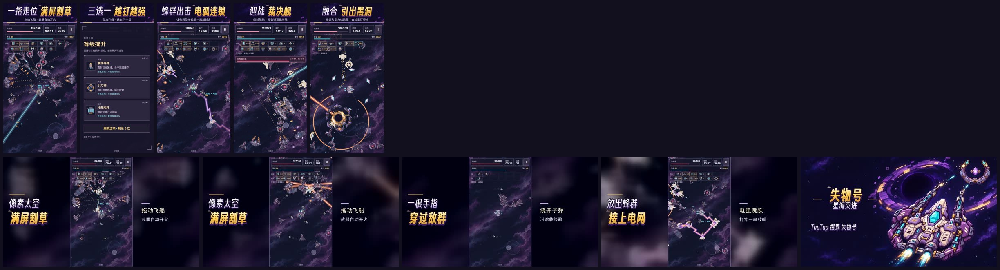
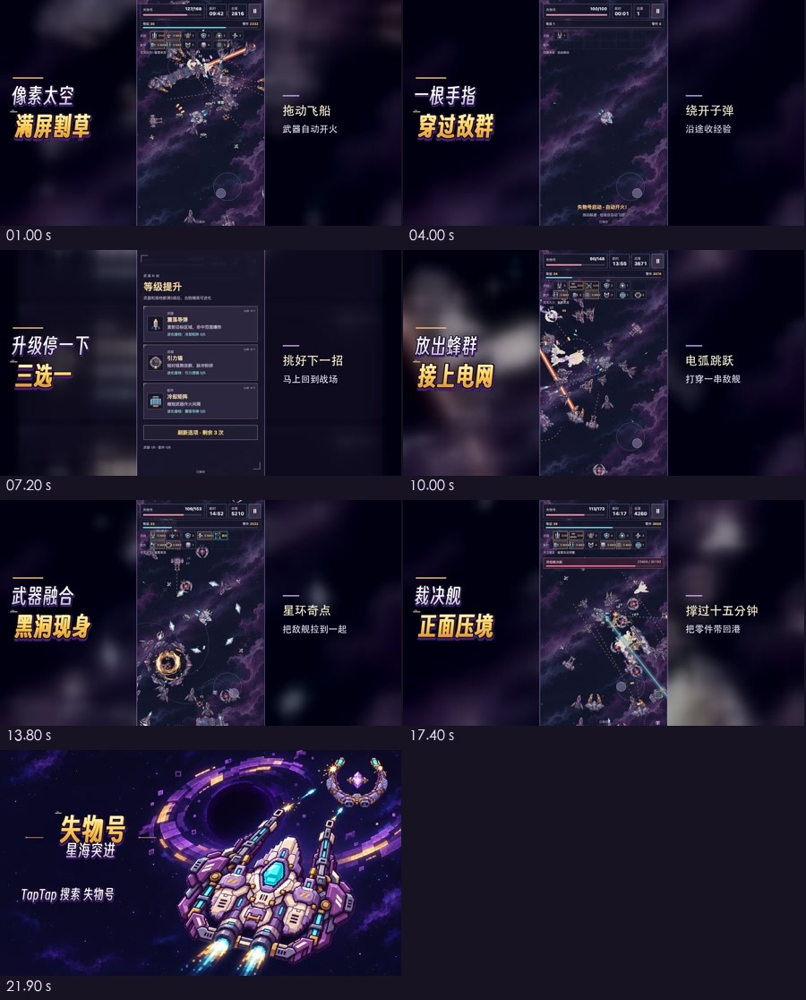

# 《失物号：星海突进》v0.6.11 商店页素材

本目录对应已试玩通过的国内 H5 包 **520084**，拍摄提交为 `2322f30`。商店资料由所有者填入 TapTap 草稿 **V-20261120**。成片和文案使用简体中文。国际草稿中的 Android 包为 `0.6.11-global.1`（版本号 2），其英文商店页可继续单独编辑。

[商店字段](listing.json) · [五张截图](screenshots/) · [24 秒横版预告片](trailer/trailer-16x9.mp4) · [预告片封面](trailer/cover-16x9.jpg) · [35 秒开局连续录屏](gameplay/first-minute-9x16.mp4) · [素材来源与摘要](manifest.json)

## 手机缩略图与剪辑预览





## 草稿填写清单

以下字段对应国内简体中文页。推荐语、简介和开发者的话可以从 `listing.json` 原样复制，保留换行。

| 后台位置 | 填写内容 |
|---|---|
| 游戏名、分类 | 保留《失物号：星海突进》，分类选「动作」。 |
| 标签 | 割草、Roguelike、像素、弹幕射击、科幻、单机。由所有者核对并选择后台实际可用的对应标签。 |
| 首页推荐语 | 一指躲弹，架起电网太空割草。备选见 `promotionTextCandidates`，只选一句。 |
| 游戏简介 | 使用 `description` 的五行短文，首句为「从一门小炮，打出一片像素星海。」 |
| 开发者的话 | 使用 `developerNote` 的 v0.6.11 更新日志。前三分钟的远距经验回收只适用于新开的航程。 |
| 详情页图库 | 顺序为一指走位、升级选卡、蜂群电网、裁决舰、黑洞融合。按 `media.screenshots` 顺序选取五张 JPG。 |
| 宣传片及封面 | 在横版「宣传片」位放入 16:9 预告片及同名目录的封面；首页推荐素材切换为「预告片」。 |
| 实机录屏位 | 放入 9:16 的 35 秒原速开局视频，保留实际游戏声音。该视频录自桌面 Chromium 的竖屏 H5 玩家入口。 |
| 平台 | Android、iOS。PC 由所有者在后台核实可开启后再勾选。 |

建议将文案、截图、预告片和封面与包 520084 放在同一份草稿，经所有者确认后一并提审，确保玩家在商店看到的就是打开后的版本。分类、标签和推荐语也可以先改。本次交付只更新 Draft PR #4。

## 拍摄依据

- **开局和选卡**来自无存档的新浏览器会话，点普通的出击按钮开始，用拖动输入操作，按画面实际给出的三张卡选取。连续录屏从首页开始，含开局和前段战斗，中间保留选卡停顿。录屏没有字幕、画中画、跳剪或加速。预告片第 3.0–6.2 秒另取新档走位实录 `opening-weave` 的 19.8–23.0 秒，HUD 航时从 00:18 走到 00:21。
- **敌潮和裁决舰**取自种子 1，**星链雷网配猎手蜂群**取自种子 4，**星环奇点**取自种子 5。准备程序逐帧运行原游戏模型，躲避、击落、获得经验，且只从实际给出的选项里选卡。采用可获得的满永久强化（船体与主炮各 3 级，三项工程各 6 级）；这些镜头展示的是进阶配装。存档经验证后载入独立浏览器档案，从普通「继续」按钮续玩。没有摆放敌人、重写计数器或在拍摄页开启 QA。成图 HUD 实读依次为敌潮 09:41／2810 击落／30 级，电网 13:56／3686／34 级，裁决舰 14:17／4256／39 级，融合 14:51／5207／33 级。清单的采样值取自截图请求发出前，拍摄瞬间战斗继续运行。
- **版式**保留完整飞船、HUD 和竖屏画面。五张截图都是 1080 × 2210，另加标题区。标题使用项目内的得意黑和既有紫金字效，小字用系统黑体。横版预告片的两侧用同帧模糊背景，结尾使用已批准的无字主视觉及项目字标。封面取自预告片正片。
- **声音**来自游戏本身。预告片配乐为项目内 `SurvivorAudio.renderOffline('music')` 合成曲的第 3–27 秒。连续录屏使用当局录到的游戏混音。字体、音乐、主视觉文件和每个镜头的入点都列在清单中。

## 重放与验收

需 Node、项目 Playwright 与 Chromium、FFmpeg、ffprobe，以及安装有 Pillow 和 NumPy 的 Python 3。成品来自版本戳为 `2322f30`、`dirty=false` 的试玩 ZIP。若本机没有上次导出的文件，可在独立检出 `2322f30` 后，从那份检出运行 `prototypes/salvage-survivor-demo/build.py --freeze` 和 `package_taptap.py`。将实际试玩 ZIP 解压到主工作区的 `releases/survivor-taptap-2322f30/`，其中应有 `loststar-survivor/index.html`。脚本在准备和拍摄时都核对版本。

在仓库根目录，先启动该固定包的本机 HTTP 服务。

```sh
node prototypes/salvage-survivor-demo/serve.cjs --root releases/survivor-taptap-2322f30 --port 4486
```

另开终端生成拍摄素材。每次重录的全新开局随机数和帧到达时刻可能不同，发布清单及其哈希对应本次实录。

```sh
S=design/star-salvage/v0611/store
node "$S/tools/checkpoints.cjs" swarm 1
node "$S/tools/checkpoints.cjs" electric 4
node "$S/tools/checkpoints.cjs" void 5
node "$S/tools/capture.cjs" opening opening-weave horde electric fusion boss
python3 "$S/tools/render.py"
python3 "$S/verify_store.py" "$S/listing.json" --enforce
git diff codex/v0611-first-minute -- prototypes/salvage-survivor-demo/src prototypes/salvage-survivor-demo/index.html
```

中间录像和准备档放在忽略提交的 `releases/store-v0611/`。变更前的六张图和线上字段保存在 [baseline](baseline/)。
