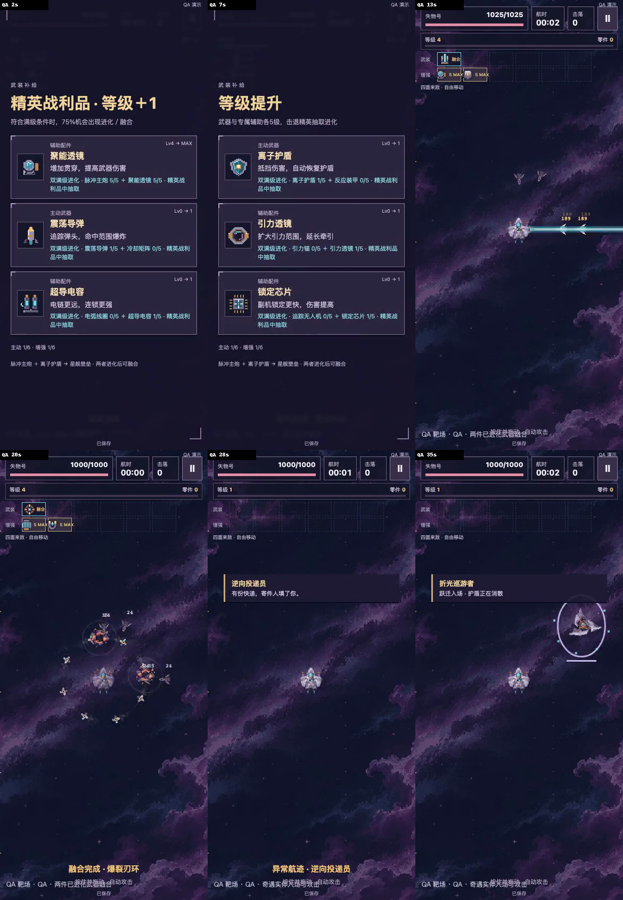

# v0.6.3 五级武装与精英战利品

TapTap开发自测 **474099**，运行源码 **f9bf85c1ac9313d44edfc63403761a648cd9b2cb**。等待用户视觉、手指操作与手机审核。PR #2继续Draft。

拖动飞船躲避，武器自动开火。请开新一局体验5＋5，旧的未结束对局继续原3＋2规则，原余额与永久强化保留。

## 本轮反馈与实际实现

| 反馈 | 实际实现 | 证据 |
| --- | --- | --- |
| 武器、辅助各5级 | 八种主动和八种辅助补齐五档真实作用，显示5 MAX | 53组模型、八配方36种等级组合、实际HTTP选卡 |
| 辅助未满不能进化 | 同时要求武器5与对应辅助5，点击及续玩重复校验 | 5＋4拒绝、过期卡片、合法5＋5选卡和刷新 |
| 进化随机出现 | 只有精英／Boss奖励抽高级卡，合格后75%，一次抽签后保存 | 1000次模型抽样、200次真实UI卡片抽样、刷新结果不变 |
| 击败小Boss再进化 | 实体击退直接升一级，保留经验，三选一奖励一次入队 | 两精英同帧死亡、待领队列、退出续玩、防重复回归 |
| 两件武器联动 | 低阶组合实际追加攻击，四组双进化终极融合释放一格 | 四融合真实伤害、自然路线实际形成星舰壁垒 |
| 奇遇缺少实体感 | 原创投递员与巡游者实际跃迁入场、短暂护盾、攻击、击退或离去 | 普通入口两次击退、QA实体连续画面和真实音轨 |

四组终极融合为无人机＋电弧、导弹＋旋刃、棱镜＋引力、主炮＋护盾。每组要求两件来源武器均已进化，辅助保留，合并后释放一格。星舰壁垒使用增强轨炮与护盾破裂反击，当前图标沿用轨炮，专属图标仍待精修。

## 固定包与实际上传

网页ZIP为 **5,016,278字节**，SHA256 `a189aa8551304e6723c1930b71ad7c2f77cb791e88bf3af17f130614258dd72c`。

TapTap ZIP为 **5,018,654字节**，SHA256 `dd5298fbb3d681e218977794e63c7e6e1f4361473f845e7fb1e3cd1fb6bd9c2e`。两个ZIP的66项payload逐字节相同，含56 PNG与2 MP3。原全部图像、两首用户音乐与存储代码的字节保持一致。

平台实际读回474099、对应文件名、5,018,654字节、竖屏和开发自测状态。前后主包模块完全一致，revision1199309。[平台回执](../../../artifacts/survivor-v063/taptap-receipt.json)记录本地包摘要，平台未返回远端ZIP摘要。

Mac原[4283试玩](http://127.0.0.1:4283/loststar-salvage/)和[4397试玩](http://127.0.0.1:4397/)已替换为该固定包。原4283页面实际刷新显示v0.6.3／f9bf85c，原可见档案仍为0局／最佳0。两端各66项HTTP资源与包摘要逐项一致。该UI核对没有导出原用户完整数据库，完整迁移由显式隔离旧档验证。

v062／470518保留[4420回退](http://127.0.0.1:4420/)，v061／469459保留4415，旧航路仍可从同源`/legacy-v051/`和4399打开。回退服务使用独立端口，端口间存档独立。已开始的新五级对局应先结算，再在原源地址切回旧代码，旧版无法继续新五级对局。

## 最终包实际验证

- 53组模型通过，包含旧版500组卡片向量对比、新5＋5、四融合真实攻击、精英追击、取消蓄力、实体瞄准与奖励队列。
- 普通包和TapTap解包各220项HTTP用例通过，共440项，Chromium／WebKit × 360×800／390×844，零失败、零跳过、零重试。
- 160条固定策略、38项音频通过。完整选择链逐步复核等级、来源和概率结果。音频使用真实输出测量，手机主观听感另行审核。
- 原4ca726f ZIP在两引擎同源HTTP中实际升级。27049零件、两种永久整备满级、原3＋2已进化和融合均保留，原记录刷新后逐项相同，新开局才启用5＋5。
- 两引擎关闭整个持久浏览器后重新打开，同一对局和下一局通过。并发、失败恢复、重复结算、旧星球／剧情／航路命名空间保护继续回归。
- 普通入口真实600秒，3399击落、32级、806零件。162.3秒与343.5秒分别取得两件进化，434.7秒融合星舰壁垒。两次来访者均实际击退，三次守卫击退。随后新开、暂停、刷新、继续、退出，记录一致且结算一次。
- 原生Mac Safari核对f9bf85c、6＋6、移动与击落、2秒刷新续玩、静音保存、恢复声音、切标签返回暂停于3秒。原4397旧战绩保持62船体／24秒／16击落／15零件。该项为电脑Safari实测。
- 40敌机、56敌弹、12危险区与6＋6实际配置持续30秒，包含真实音乐、音效和自动保存。桌面P95为Chromium16.7ms、WebKit20ms，实际友弹峰值5／6，未声称72友弹同时压力通过。[性能与持久化记录](../../../artifacts/survivor-v063/compatibility-performance.json)。

两路最终GitHub工作流的五项任务及其远端66项源码核对，记录于PR最新交付回执。[固定证据校验](../../../artifacts/survivor-v063/verification.json)将版本、素材、录像和测试分别绑定，证据提交与运行源码分别登记。

## 连续演示

[普通入口十分钟与真实续玩](../../../artifacts/survivor-v063/natural-ten-minute-ui-silent.mp4)为390×844完整页面、实际时间、无音轨。输入根据可见敌人、危险区、掉落和实际卡片标题自动操作，没有QA、导入或时间／种子跳转，真人熟练度仍需单独判断。

[四融合与实体奇遇实际混音](../../../artifacts/survivor-v063/qa-progression-with-mix.mp4)为实际Canvas与最终音乐／音效总线，无麦克风。[完整UI版](../../../artifacts/survivor-v063/qa-progression-ui-silent.mp4)无音轨。QA显式配置高船体、五级装备、精英与概率结果，使用独立数据库。八段实际记录与普通路线分开统计。

## 自检修正与待审

连续游玩发现首个候选4cdd7b5的精英追击距离落在屏外，离开蓄力射程后还会卡住，已修正并重新录制最终完整十分钟。放大的奇遇机体与喷口曾使用不同缩放，f9bf85c统一机身、尾焰、喷口与血条尺寸，增加真实Canvas绘制几何回归。旧候选记录保留为历史，最终成绩全部来自f9bf85c。

基础与满永久的护盾优先模型仍偏弱，960零件整备在十分钟收入下升满较快。当前五种模型没有专门导弹＋旋刃优先策略，爆裂飞轮自然策略样本0次，实际QA已验证合法选取和真实攻击。QA底部说明和普通提示有局部文字重叠，普通玩家入口没有该QA说明。[经济与策略详情](BALANCE_REPORT.md)。

真实手机的触控、混音听感、物理锁屏、发热、特效可读性、十分钟节奏和组合趣味仍待474099复审。内部画面与工程验证各自登记，用户视觉与趣味尚未签收。
