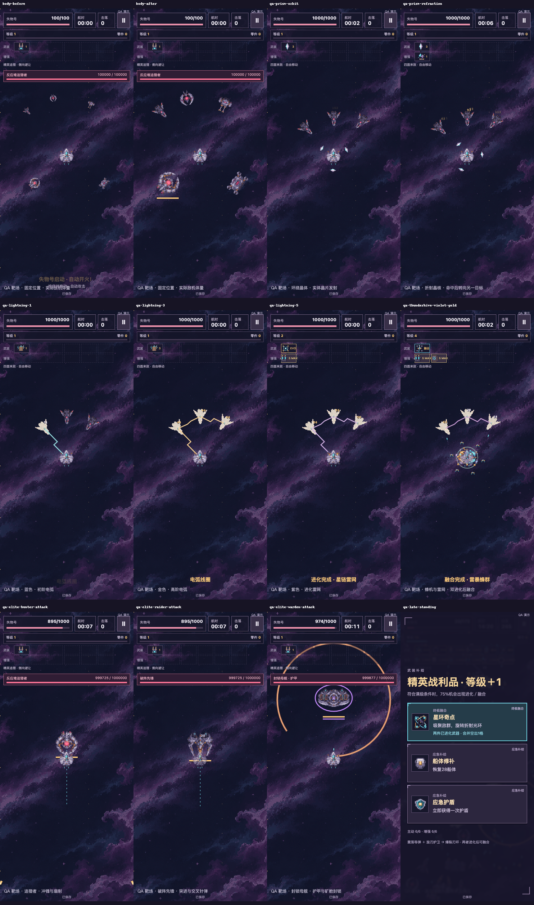

# v0.6.4 十五分钟星海开发自测

TapTap开发自测 **474770**，运行源码 **15f43c14a0f313b415fdfb5e9c3a6cac341a6777**。PR #2继续Draft，等待用户视觉、手机操作和趣味审核。

拖动飞船躲避，武器自动开火。开新一局体验十五分钟与新弹道，已有未结束的对局沿其保存规则继续，余额和永久强化保留。

## 逐项反馈与实现

| 用户反馈 | 本版实现 | 固定证据 |
| --- | --- | --- |
| 敌人太小 | 普通敌机恢复2倍原生像素，来访者3倍，喷口与尾焰同一变换 | body-before／after、Canvas实际drawImage几何 |
| 棱镜与轨炮重复 | 1～5颗晶体环绕，真实晶片命中后折射，进化6晶阵 | 实际晶体原图、连续QA、实体二次命中 |
| 雷电一直蓝色 | 低阶蓝、3级后金、进化紫，蜂群融合紫金 | 三档实际Canvas线色与连续实录 |
| 蜂机开始就追踪 | 普通发射锁定瞬间位置后直行，5＋5进化才追踪 | 浏览器触控事件选卡、目标移动、发射属性存档 |
| 导弹开始就追踪 | 基础导弹直达锁定区域爆破，进化后追踪 | 目标移位与实际轨迹、刷新保持 |
| 前期升级快、后段轻松 | 新经验曲线、轨炮频率调整、后期交叉火力和回响攻击 | 160＋20策略、普通连续实录、最大配置受损 |
| 十分钟短 | 新局900秒，已有180／600秒对局保留 | 新旧档同源迁移、真实900秒截止与一次结算 |
| 精英辨识度低 | 追猎者冲锋扇射、先锋突进针弹、母舰护甲布雷扫射 | 两张新原创机体、三类实体实际伤害 |

数值原值、新值和调参依据见[实际平衡报告](BALANCE_REPORT.md)。收费与永久权益使用原模型。

## 固定包与平台回读

网页包 **5,026,189字节**，SHA256 `e21e45e7c4f4e35c80ab69d281dbf82272872a4c2d9942957ad64229b36ad9ff`。

TapTap包 **5,028,673字节**，SHA256 `6d0441f1f6a12ca28b5f337c4f24abe228751ad107c9066abdf02ae5dcbb4921`。两个ZIP的69项payload逐字节相同，含59 PNG和2 MP3。原56 PNG、两首用户歌曲及存储实现字节保持一致。新增两机体、一晶体保留原始生成图、1×、ORA、2×／4×及导出清单，主代理复核了轮廓、实际比例、喷口与实录。

平台读回474770、实际文件名、5,028,673字节、竖屏与开发状态。主包模块前后相同，revision1199309。[平台回执](../../../artifacts/survivor-v064/taptap-receipt.json)记录本地摘要，平台没有返回远端ZIP摘要。

Mac原[4283试玩](http://127.0.0.1:4283/loststar-salvage/)和[4397试玩](http://127.0.0.1:4397/)已使用该固定包，两端各69项HTTP资源逐项相等。实际原4283页刷新显示v0.6.4／15f43c1，原可见档案摘要保持0局／最佳0。该项核对可见UI，完整旧档权益由显式隔离副本验证，未导出原用户完整数据库。

v063／474099保留[4428回退](http://127.0.0.1:4428/)，v062／470518仍为4420，v061／469459仍为4415，旧航路保留同源`/legacy-v051/`与4399。不同端口的存档相互独立。新900秒对局先结算，再于原地址切回旧代码，旧代码无法继续新规则对局。

## 最终包验证

- 70模型组通过，含原53组、旧随机卡片向量、5＋5、四融合、真实晶片折射、冻结弹道、三精英和Boss回响。
- 普通包和TapTap解包各260项真实HTTP用例通过，共520，Chromium／WebKit × 360×800／390×844，零失败、零跳过、零重试。实际资源读取、触控事件、画布变换与持久化分别检查。
- 160条固定方形移动和20条预警规避策略完成，原始选择链逐步校验。38项双引擎音频通过，使用真实输出测量，手机主观听感待审。
- 两种实际旧ZIP × 两引擎共4条同源迁移通过，27049余额、原永久满级、旧3＋2／5＋5进化与融合完整保留。整个持久浏览器关闭后重开、下一局、并发、失败恢复、重复结算和旧命名空间保护继续验证。
- 普通入口第2次达到900秒，2844击落、33级、1582零件。失败尝试保留。随后开新局、暂停、刷新、继续、退出，同一记录恢复且一次结算。
- 原生Mac Safari实际核对15f43c1、15分钟、6＋6、移动与击落、5秒刷新续玩、静音保存、恢复声音与切标签返回10秒暂停。原4397旧战绩保持62船体／24秒／16击落／15零件。
- 40敌机、56敌弹、12危险区、6＋6配置持续30秒，包含音乐、音效和自动保存。桌面P95为Chromium16.7ms、WebKit21ms，上版约16.7／20ms。本版友弹实际峰值9／8。该测量运行于Mac桌面，物理手机性能单列待审。

全部结果与摘要由[固定证据](../../../artifacts/survivor-v064/verification.json)绑定，最终push与PR两路五项CI及其远端69项源码核对另在PR交付回执登记。

## 连续录像

[普通入口十五分钟与真实续玩](../../../artifacts/survivor-v064/natural-fifteen-minute-ui-silent.mp4)为390×844完整页面、真实时间、无音轨。片头保留上一场失败的末段与实际160零件整备，随后连续保留完整900秒、结算和刷新续玩。原始整段保留于本机，媒体摘要记录697秒裁切起点与1倍播放速度。自动输入只响应可见实体和实际卡片，未用QA、导入或时间／种子修改。全部尝试记录在[natural-report.json](../../../artifacts/survivor-v064/natural-report.json)。

[晶体、弹道、雷电与精英实际混音](../../../artifacts/survivor-v064/qa-weapons-elites-live-mix.mp4)录制实际Canvas与最终音乐／音效总线，无麦克风。[完整UI版](../../../artifacts/survivor-v064/qa-weapons-elites-ui-silent.mp4)无音轨。14场显式配置高船体、装备、敌机、后期时钟或概率，QA标签保留，与自然路线分开。

## 内部复核与待审

逐帧对照旧f9bf85c同位置敌机、实际晶体绕行和反射、蓝金紫放电、三精英预警与伤害。初版仍使用旧炮塔式棱镜图标，内部审图后补做独立晶体，最终环绕、弹体和基础图标统一接入。精英受击白闪降至0.28，轮廓与材质在集中攻击下仍可读。续局按钮残留10分钟已修正后重新冻结及回归。

引力优先策略仍弱，固定方形移动容错较低，960零件永久整备在长局收益下仍较快升满。星舰壁垒专属图标仍沿用已认可轨炮，独立图标待后续精修。真实手机触控、TapTap跨包续档、听感、锁屏、发热，用户对敌机大小、晶体、精英造型及十五分钟趣味均待本包审核。
