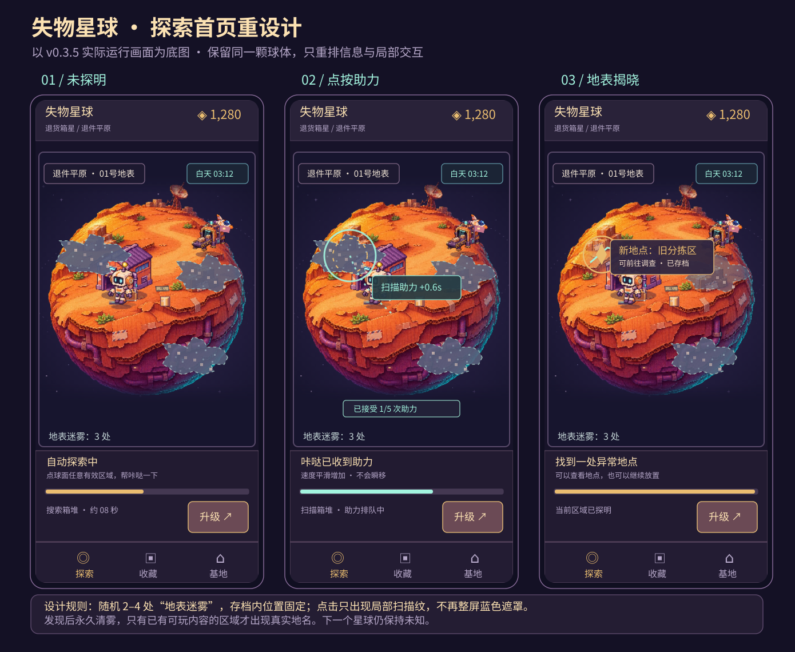
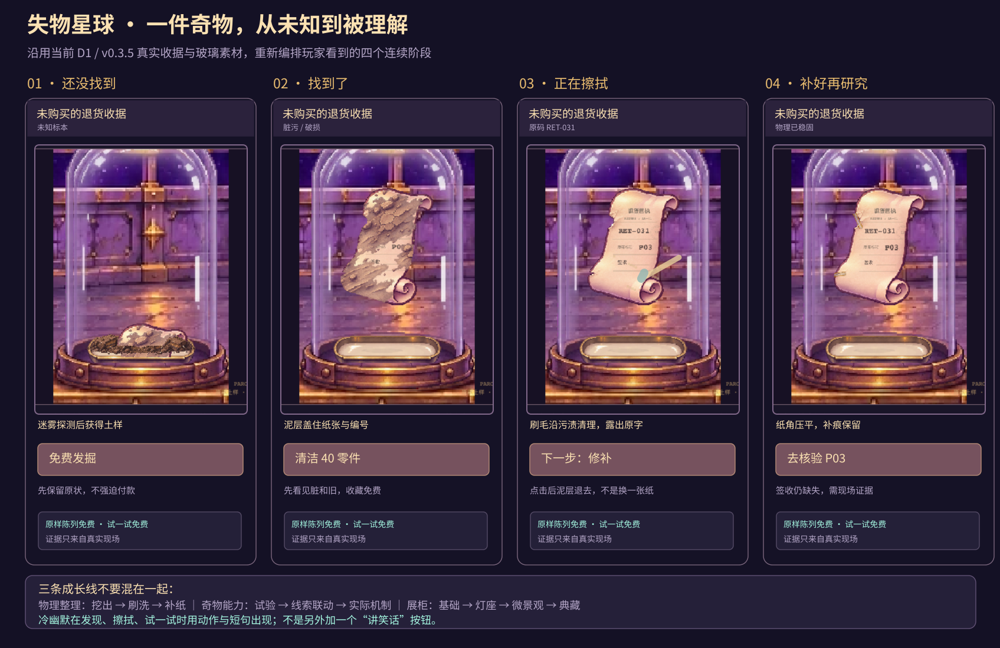
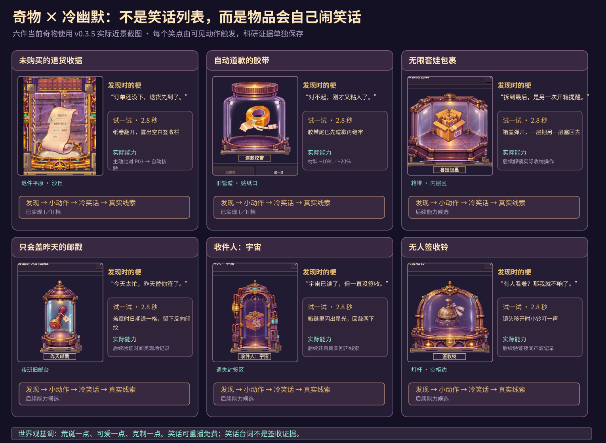
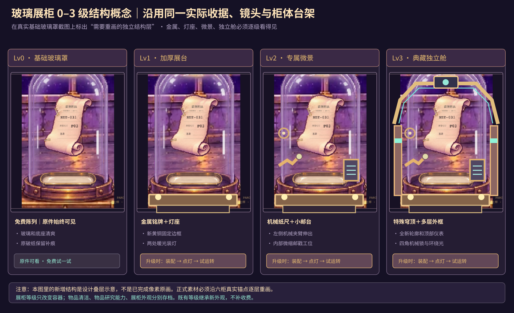

# 《失物星球》V0.3.6：固定小星球／局部迷雾／奇物冷幽默的视觉定稿候选

## 已认可原图与本轮运行样板

两张新下载的原始PNG已按用户指示原样导入。下列原图优先于本页早期SVG草图，字节数与SHA-256记录于[原图清单](reference/manifest.json)。

- [探索流程概念原图](reference/失物星球探索流程概念图.png)
- [奇物修复展陈概念原图](reference/失物星球_奇物修复展陈方案.png)

本轮按[已确认实施标准](APPROVED_ART_IMPLEMENTATION.md)只制作一处星雾与一件收据两个隔离运行样板。开发入口为 `/?sample=art-v036`，独立生产构建使用 `npm run build:v036`。原图作为审核参考保留，新绘制分层素材与现有球体、原纸及玻璃材质在Canvas中运行。

以下章节记录此前截图与SVG候选的历史过程。

> **仅设计交付，不是已完成的运行时新玩法。** 2026-11-05 根据 TapTap **433104 / v0.3.5 / 8cb462c** 的实际运行截图重新制作。提交到既有 Draft PR #2。用户审核完视觉/节奏以后，再由 Codex 修改正式游戏。未经确认不更改玩家存档、不开放第二星球、不发布。

## 本轮四张概念图（嵌入真实运行截图作为底图）
1.   
   **[全尺寸查看](01_explore_fog_click.svg)**：源为 `artifacts/refinement/390-explore.png`。保留现在的完整像素球体，减少首屏空白，改局部触摸反馈，3个有界地表迷雾。
2.   
   **[全尺寸查看](02_receipt_discovery_cleaning.svg)**：实际源为 V0.3.4 收据四阶段运行截图，不把样板预算当玩家真余额。提炼可复用“发现前/发现后/清洁/修复”的单物件展示模型。
3.   
   **[全尺寸查看](03_six_curios_humor_matrix.svg)**：源为 V0.3.5 的六件 `closeup-*.png` 真正运行截图。已实现收据／胶带本体Ⅰ／Ⅱ级，其余四件能力明确标为**候选**。
4.   
   **[全尺寸查看](04_cabinet_structure_levels.svg)**：底图来自实际基础玻璃罩，后来叠加的金属、灯、机械与典藏舱仅是**设计标注层**。它们尚不是已制作完成的像素纹理，落地需按真实展台坐标重新制作分层像素图。
5. **[交互演示（下载 HTML 用本地浏览器打开）](interactive_review.html)**：包含嵌入的 V0.3.5 真实运行截图；点击三次观察一处地表雾逐渐消失，收藏页可切换同一收据的脏/净/修补图。**交互完全在内存里，仅示意，不连接正式存档、不对接真实金额与奖励**。

> 这些 SVG 以原始运行截图为底图，再叠加概念 UI／局部迷雾／设备形态。它们的准确角色、场景底色和展柜主体是真实项目美术；新遮罩、按钮、结构发光只是拟定效果，必须通过真实 Canvas/像素原画复刻，不能把矢量叠层当已完成游戏资源。

## 1. 核心玩法冻结候选

**固定一颗完整微缩星球 → 自动探索/玩家点一下助力 → 逐个拨开本星球随机的局部迷雾 → 真实发现奇物或区域 → 清洁修补／免费试一试 → 独特冷幽默动作＋可追溯证据 → 安排研究或升级 → 留下持久变化。**

绝不是点击星球生成随机新星球，也不是把整颗星球永远糊成浓雾。只允许**当前已发现的退货箱星地表**出现雾，星际未知仍遵守独立、隐藏、真正可玩才揭晓的旧规则。主画面不出现未发现星球的名字、节点数量、位置和外形。

## 2. 固定球体上「随机几处迷雾」的规则

**建议初始3处，内容丰富时可配置2–4处**；它们在一个存档中出现一次之后位置固定，离线/刷新/跨标签不变化。

### 内容与随机位置分离
- **底层固定**：星球球面、建筑、飞船轨道、收件站、全地图局部设施、机器人及居民真实接触点不变；
- **雾遮的位置可变**：从美术审核过的、不会遮住首页收件站/机器人或跑出球体的 8–12 个安全地表锚区中，按 `hash(saveSeed, planetId, layoutVersion)` 一次抽取2–4处，选择不重叠的点，**不是随机生成新地貌/假建筑**。
- **雾必须有真正的内容**：初版只为已实现节点（例如旧分拣区、已制作好的箱标线索）开启永久“发现奖励”；没有真实内容可揭晓的区域只保留自然云雾氛围，不向用户承诺能找到奇物。
- **已发现玩家兼容**：旧存档中已经完成的区域直接显示为揭晓状态；不得用新雾重新盖住已发现的东西、重复扣零件或重新发奖励。
- **同一地表雾的阶段**：`undetected（未知）→ signal（微弱回波）→ scanning（局部可见扫描进度）→ revealed（雾颗粒散去并露出真实设施）→ archived（航路和发现永久保存）`。每一步源于同一真实任务，不能凭点击次数凭空发放物品。
- **点击不是强制门槛**：自动机器人会逐步探明区域；点击星球仅贡献有界临时工作助力。夜晚点按只聚焦事件，仍由设备和机器人自动处置。
- **随机不会重新洗牌**：使用持久 `fogSeed` 和稳定 `fogId`，区域内容ID独立于屏幕雾位置；版本更换时对旧区域位置做兼容，不让雾突然跳位。
- **手机性能**：雾形用少量像素化多层纹理及 alpha 遮罩，不做重型后处理；同屏≤4朵可调查迷雾，0.6–0.9秒阶梯式消散。场景前后遮挡、光线和球缘裁切必须正确。

## 3. v0.3.5 首页实际问题与重排原则

对照实际 `390-explore.png` 与 `390-assist-feedback.png`：

- 现状完整球体已具良好基础，但上下暗空白相对多；**保留原球体完整轮廓，视觉占据优先**，压缩不必要顶部与底部空白，而不是把画面变成半球；
- 现状助力反馈会出现较大范围蓝色覆盖；概念改为**触点局部像素环→咔哒作业点短光迹→进度助力段→实际卸货浮币**四步。反馈要“看得见且不盖住星球”，失败/冷却用轻提示而不是整屏遮罩；
- 顶部：星球名／零件／小型昼夜状态；中央：完整球体、2–4个局部迷雾与机器人；下方：单行作业状态、进度、升级；底部探索／收藏／基地3个固定导航。手机 360×800/390×844 两版都应可读。
- 每次点击只改变已有任务的工作量，原有效间隔/队列与去重预算可保留；点击不能导致脚点瞬移、货物分身或重复发奖。
- “发现前”和“发现后”必须有**真实球面变化**：雾下区域变可见/设备发亮/机器人前往该地点，不是只出现一条文字“已发现”。

## 4. 三种升级必须彼此独立

| 玩家想做什么 | 作用和视觉反馈 | 消费边界 |
|---|---|---|
| **整理旧物（物理状态）** | 脏旧→刷洗→修补。原墨、缺字、补纸仍真实存在，工具接触/刷毛擦拭能看见。 | 一次性消耗零件；免费陈列和试一试始终可用 |
| **研究奇物（本体能力）** | 小卷边→多折页→自动核证；胶带由普通粘→固定真实纸路，动作和实际已存在的任务效果同时变化。 | 需要真的有已实现内容及可验证收益；现有收据／胶带 I/II 承接旧权益 |
| **升级玻璃柜（展柜结构）** | Lv0基础罩→Lv1黄铜灯座铭牌→Lv2专属微景/机械→Lv3真正独立典藏舱轮廓。 | 纯陈列结构与灯光，不凭柜子等级虚构奇物线索；已购等级直接获得新视觉，不重复收费 |

尤其注意：**收据的签收栏缺失是事实**；花零件只能清洗/修补、让研究能对照真实 P03/P30 记录，不能印出从未发生的签收。原 V0.3.5 已有核验能力，后续设计只能在真实证据基础上强化反馈。

## 5. 奇物冷笑话，必须“演出来”

### 小演出公式
`地点伏笔（0–1秒）→ 奇物自行做傻事（1–2秒）→ 一句6–18字的冷幽默（停2秒）→ 可点查看真实来源或再试一次`。

笑话可以免费重播，每件首次发现最多一句大提示；不要重复弹窗阻碍自动远征。**笑话标记 `kind=flavor`，正式证据必须 `kind=evidence` 且有实际来源、时刻、actionId，不能混在同一业务字段。**

| 奇物 | 笑点与动作 | 本体实际成长 |
|---|---|---|
| 未购买的退货收据 | **“订单还没下，退货先到了。”** 旧卷纸抖开，主动出示不存在的订单栏 | I/II 真实箱标核验（已实现） |
| 自动道歉的胶带 | **“对不起，刚才又粘人了。”** 尾带伸出，把刚粘好的东西又礼貌扶正 | I/II 真实工程材料和清纸收益（已实现） |
| 无限套娃包裹 | “拆到最后，是另一次开箱提醒。” 最内层弹出新小纸条 | 后续候选，不冒称已实现 |
| 昨天邮戳 | “今天太忙，昨天替你签了。” 印章落下，日期退格 | 后续候选 |
| 收件人：宇宙 | “宇宙已读了，但一直没签收。” 箱缝回闪两次星光 | 后续候选 |
| 无人签收铃 | “有人看着？那我就不响了。” 视线转开，铃只在背景轻响 | 后续候选 |

**组合梗不只是文案**：例如收据+胶带都已取得时，做一次非强制的“胶带替收据道歉”短互动：胶带主动贴住“尚未购买”的栏目，收据吐出“这单连道歉都预付了”。这条是纯风味，不给额外重复资源，不篡改证据，可在首次双收藏后触发一次、以后由图鉴重播。

## 6. 一颗星球的可复制制作模板（后续矩阵）

| 固定模板槽 | 每个星球的内容要求 | 和后续星球的关系 |
|---|---|---|
| 微缩星球主视觉 | 完整闭合球体、一个清晰核心建筑、球面前后遮挡、局部明暗与飞船轨道 | 复用结构与技术，**美术地貌需原创，不靠换色** |
| 迷雾锚区 | 2–4个持久局部地表雾，内容就绪才随机布置 | 单星局部探索，和星际未知雷达分开 |
| 探索内容 | 至少1已实现地标、1小障碍、1有来源的事件链 | 游戏进程可玩，不是假锁定 |
| 奇物套件 | 每件独立造型、出土状态、清洁/修补、免费试一试、本体能力与笑点 | 统一管线，具体表演不能复制粘贴 |
| 居民与昼夜 | 有吃/走/休息的日常行为，夜里异常处置与维修同一球体 | 保持低频放置，不做密集塔防 |
| 收藏室 | 真实玻璃层、6柜锚点及0–3结构升级 | 展示架构复用，但容器类型可以变 |
| 星图解锁 | 仅当该星球包含可用场景、生物、奇物、事件后可正式揭晓 | 不预告未发现星球名字/位置/数量 |

**每个节点有完整的内容包**：`PlanetRegion {regionId, fogAnchors[], sceneAdapter, entryCondition, obstacle, artifactSources[], creatureActivities[], encounterEvents[], gagActions[], researchOutputs[], unlockAfterEvidence[]}`，字段名称是设计建议，不是已改代码。所有“完成”要以有真实美术+可执行互动+存档记录为门槛。

## 7. 下一轮 Codex 的最小交付（先看概念，再开工）

**阶段 A（本次）：** 四张现状截图基础上的视觉概念图 + 单页交互预览 + 本规范。只审美术与流程，不改游戏运行代码。

**阶段 B（用户确认后）：** 在隔离预览里做 `390×844` **20秒局部扫雾**、**15秒找到奇物→刷洗→冷笑话** 与 **15秒一件奇物能力前后对照** 的真实连续动画。随机固定种子用测试配置重放；同时做 `360×800` 边界和点击触控观察。不要从现在开始就量产多个未做完的区域。

**阶段 C（视觉通过后）：** 将同源状态和证据接进正式存档，验证点击/离线/旧权益/无剧透/经济；先退货箱星一个节点，后续才按模板逐星扩展。

**必须明确保留：** 2026-11-05 基线为 `8cb462c` / TapTap `433104`；本设计提交仅增加 `design/v036/` 下的文件。GitHub PR #2 保持 Draft，不合并、不正式发布、不开放第二颗星球。

## 8. 视觉审核检查

- [ ] 能看出仍是 V0.3.5 的同一颗球体/机器人/飞船/玻璃柜，不是另起新风格？
- [ ] 点击反馈是否局部、清爽、不遮挡整颗星球？放着不点是否仍持续探索？
- [ ] 迷雾是本星球少量局部遮罩，不是全屏滤镜和未解锁星球节点？
- [ ] 发现前后是否发生真实地貌、机关或场景变化？迷雾里有真正制作好的可玩内容？
- [ ] 收据或胶带清洁动作是否有接触过程，付费前后肉眼能辨？证据是否保持真实？
- [ ] 每件奇物的梗是否由它做的动作触发，而不是塞一个文字笑话列表？
- [ ] 物理整理、本体能力、玻璃柜结构是否明确是三条不同成长？
- [ ] 普通新玩家与高余额旧档的资源、收藏和权益能无损迁移？
- [ ] 用户通过设计后，才制作隔离样板并考虑接入？
