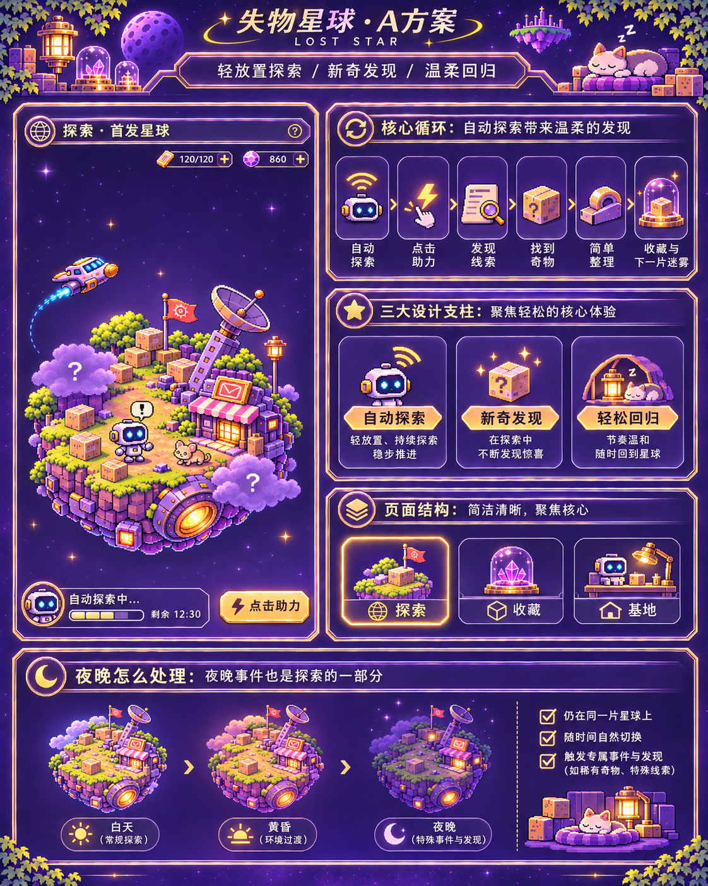
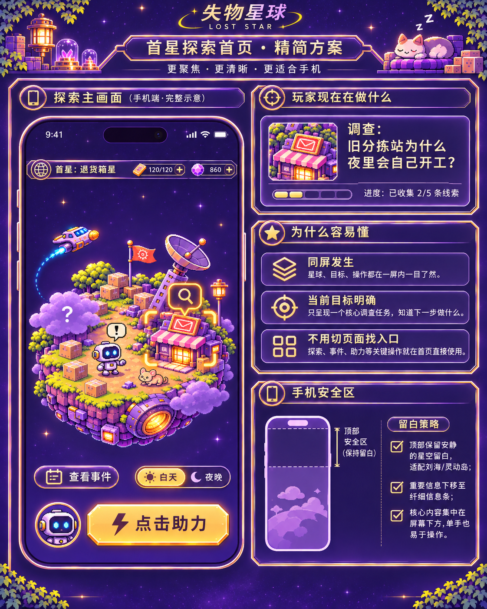
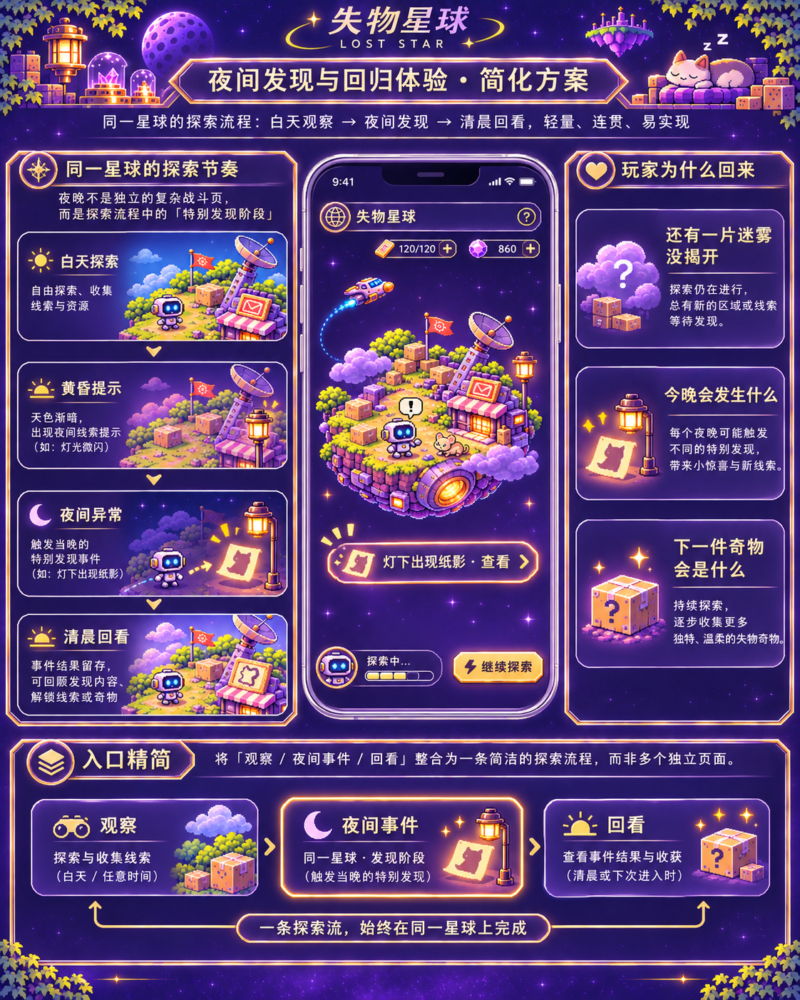
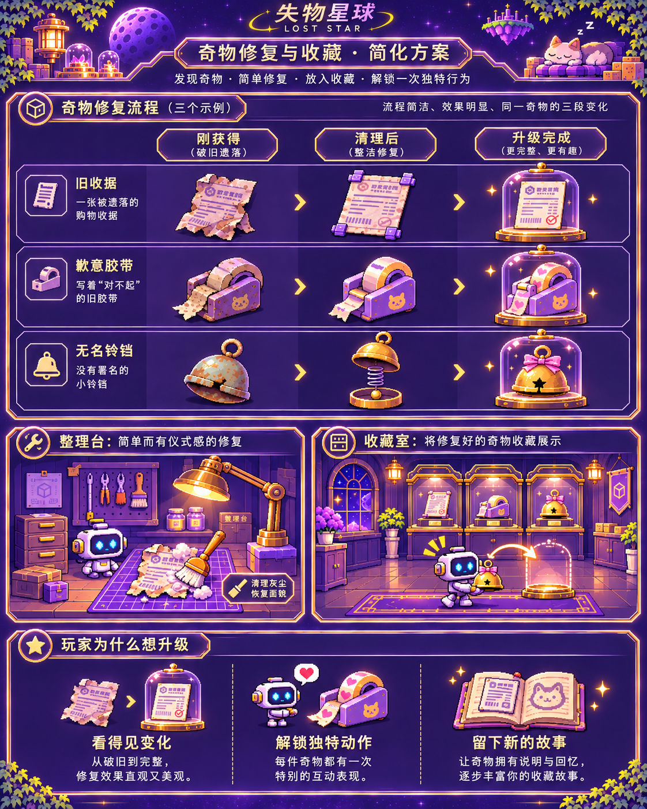

# V0.4.5 · A方案：简单放置探索、新奇发现、温柔回归

2026-11-06 用户确认的四张完整PNG已按附件原字节导入，尺寸、字节数和完整SHA256见[manifest.json](manifest.json)。源是本机可访问的下载附件，不假设ChatGPT的/mnt/data存在。此提交只冻结批准参考与产品取舍，**不宣称A版运行实现或手机验收已经完成**。

## 四张图的职责

|原图|负责内容|
|---|---|
|[01_a_direction_board.png](approved/01_a_direction_board.png)|A方向总板：自动探索→点击助力→线索→奇物→简单整理→收藏与下次期待；探索/收藏/基地三个主入口。|
|[02_first_planet_home_simplified.png](approved/02_first_planet_home_simplified.png)|探索首页：顶部安静安全留白、细信息条、完整星球、一个清楚调查目标、当前事件和可感知助力。|
|[03_night_discovery_flow.png](approved/03_night_discovery_flow.png)|同一颗星球上的白天探索→黄昏提示→夜间特别发现→清晨回看；观察/夜间事件/回看合并一条探索流。|
|[04_curio_restore_collection.png](approved/04_curio_restore_collection.png)|收藏：六物18张完整状态图保持；刚获得/清理后/升级完成简洁可辨，每件修好后只突出一个代表互动。|

## 当前产品方向

玩家回来是为了发现这颗星球还藏着什么。默认自动探索，轻点帮忙，发现留下简短线索；夜晚是同球探索的一部分，早晨温柔回看成果。收藏和整理服务于发现感。基地只承接轻量成长和必要设施，不承担多系统并排管理。

所有概念板均为参考拼版，不是可直接剪切的场景/分层生产图。复用现有高完成度独立运行素材，按批准构图重排真实UI与动态场景；不得整张海报当H5界面。图中示例宝石/体力数值、固定问号、额外星球外形、示意时间/进度不构成新规则：仍只有零件，自动探索默认开启，未发现星球不泄漏数量/名称/外形/位置，不开发第二星球。

## 本轮废止、合并或降级的旧呈现

- 废止独立夜间打怪页和以防御配置为主角的普通玩家流程。
- 合并分散的观察/巡逻/夜间事件/故事回放入口为探索页的一条事件流；清晨结果和上次发现从同一入口抵达。
- 移除探索首页上的设备/用途/设置/独立星图等次级按钮堆叠；必要功能归入基地收拢管理。
- 降级并排的建设/安保/站务/科研/工程说明入口、长术语和重复解释。现有付费设施及数值效果不删除，必要操作收在轻量基地内，保持兼容和原权益。
- 工作台不再并列长解释/多套操作，主操作顺着三态变化；修好后只保留该物件的代表互动。已购研究和展柜效果继续，不重复收费。

以上是用户最新明确替代的UI/产品表达要求，优先于历史多入口/防御主导方案。历史实现与证据保留版本归属，不能作为A版已接入的证据。

## 保留内容和兼容边界

保留自动探索、有界真实连点助力、完整2.5D微缩球体及轨道遮挡、局部迷雾、白天/黄昏/夜间/清晨、三居民、六件奇物与18张独立完整状态图、真实处理完成后整图切换、收藏室六柜和取放、图鉴与离线回归。

继续loststar.fusion.firstplanet.v037当前档；余额、收藏、整理、展柜0–3、设备、科研/本体能力、安保、施工、证据/雾种子与旧源备份完整保留。费用/时长/奖励与实际工作规则复用既有模型；本轮先收拢表现，不另造货币或强迫连点。收据修纸不补造签收事实。

只有确实改变玩法本质、收费或损坏旧档兼容时另列决策，其他已批准工作持续推进。只开发退货箱星，继续Draft PR #2，不合并、不提审、不正式发布；完成后仅上传新的TapTap开发自测包，明确运行SHA及真机待测项。

## 原图预览

