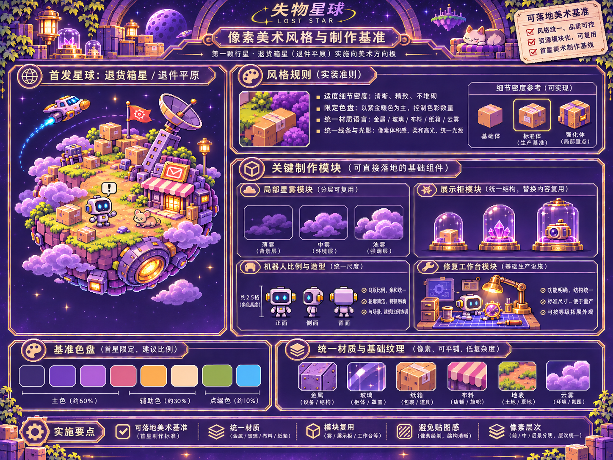
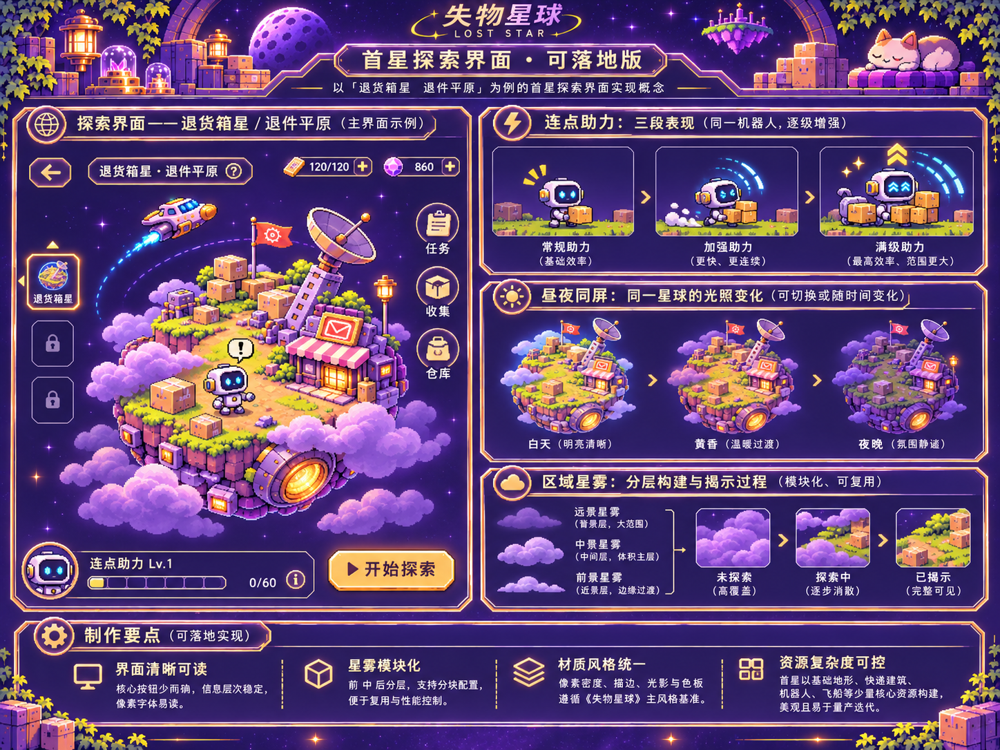
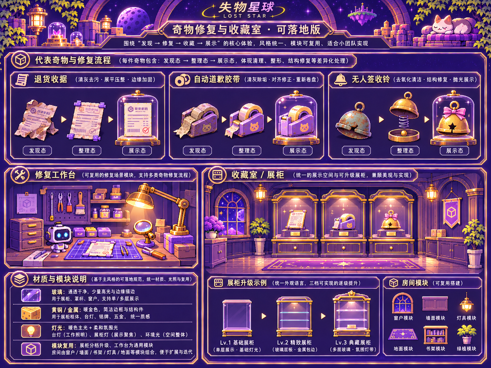

# 首星整体美术翻新 · 已确认的可落地设计基准

2026-11-05。用户确认最新三张“可落地版”PNG，要求**首星整体翻新**，不再局部拼补旧美术。保留游戏身份、已验证逻辑与当前存档；本批先首星，不开放第二星球。

## 原图与上传状态

**原图已导入 Git，三张均通过 3/3 校验。** 来源为本机下载的 `loststar_visual_renewal_pack.zip`，使用本目录脚本导入，原始字节未压缩或重采样。提交记录及远端回读结果见下方校验记录；此状态仅代表参考原图交接，不代表翻新完成或手机视觉验收通过。

```bash
python3 design/visual-renewal/import_reference_pngs.py --source /本机真实路径/loststar_visual_renewal_pack.zip
python3 design/visual-renewal/import_reference_pngs.py
```

不要使用 ChatGPT 的 `/mnt/data` 路径作为本机文件路径。脚本不会联网、不会自动 git push，也不会操作玩家存档。

| 原图 | 仓库目标文件 | 用途 |
|---|---|---|
| 失物星球像素美术基准板.png | `approved/01_pixel_art_production_baseline.png` | 统一像素密度、材质、比例、模块 |
| 失物星球首星探索界面概念板.png | `approved/02_first_planet_exploration.png` | 球面、助力、昼夜、星雾 |
| 失物星球_奇物修复与收藏室.png | `approved/03_curio_restoration_and_collection.png` | 三态、工具、工作台、收藏室 |

三图均为1448×1086原始PNG；逐文件尺寸、字节数、SHA256见 `ASSET_MANIFEST.json`。原文件不压缩、不重采样、不重新生成。仅改成英文目标文件名。

## 生效优先级

1. 本目录这三张可落地版PNG：最新美术参考。
2. `CODEX_FULL_RENEWAL.md`：玩法边界、制作流程和验收标准。
3. 既有代码：参考真实任务、存档和技术架构，不作为必须保留的旧美术。
4. 旧SVG叠图、旧海报及旧修补方案：历史资料，不再作为新视觉验收依据。

概念图是风格参考，不是可直接裁成完整游戏的素材图集。图中双货币、体力、未知星球锁格、开始探索按钮和示意等级，不自动成为新玩法。保留零件单货币、自动探索、未知星际不剧透和既购权益。

## 执行入口

完整任务：[CODEX_FULL_RENEWAL.md](CODEX_FULL_RENEWAL.md)。用户已授权按该方向推进全部首星翻新；分阶段自检后继续实施，最终手机体验由用户验收。继续现有Draft PR #2，不合并、不正式发布、不清存档。

## 原图预览







## 校验记录

2026-11-05：从真实下载 ZIP 导入，随后不带 `--source` 复验，3/3 原图的 PNG 签名、1448×1086 尺寸、字节数及 SHA256 全部符合清单。Git 二进制提交及远端逐文件回读另记于 `IMPORT_VERIFICATION.json`。
