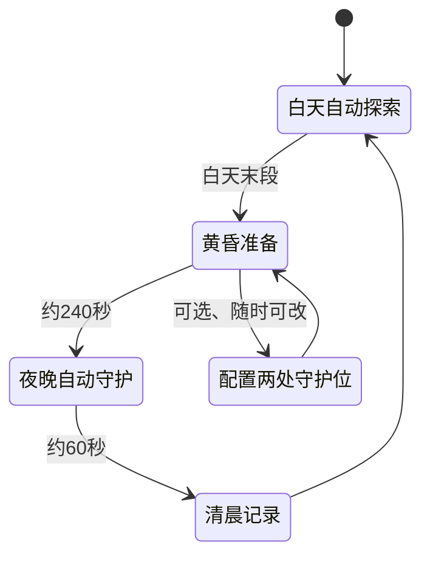

# 退件平原：奇物自动守护原型（设计草案，默认关闭）

本页依据 [PR #2 实机 Review](https://github.com/sy0310/loststar-game/pull/2#pullrequestreview-5747020255)。先修复飞船、雷达、奇物互动并上传新自测，再实现本原型。只使用退货箱星；未确认前不并入主流程，不修改或惩罚正式存档。

| 方案 | 体验与视觉 | 开发成本（相对估算） | 取舍 |
|---|---|---|---|
| 纯夜间环境＋随机事件 | 变暗、亮灯、收到一份故事；几乎零操作，但藏品缺少用途 | 低：环境时钟＋事件文案＋结算 | 可作氛围底层，策略反馈有限 |
| 奇物布置自动守护 | 两个已发现奇物位置，自动减速/震荡；球体、机器人、飞船共同守护 | 中：额外增加装备状态、单敌人模型、自动效果、离线和回归 | 本次选用；低频选择，观看自主变化 |
| 传统即时塔防 | 放置炮塔、路径、怪物波次与及时操作；主玩法变成战斗管理 | 高：需要地图/路径/密集单位/经济平衡/操作与大量美术 | 不制作，偏离放置探索与首星范围 |

成本按需要新增的系统估算，不是已经完成的工期承诺。原型只验证第二种方案的趣味。

标准节奏：白天240秒（含最后12秒黄昏）＋夜晚60秒；仅实验参数。一个星球、一种“异常退件影子”、两槽、两件可用奇物（已发现的道歉胶带/无人签收铃）、一个夜间事件“请替宇宙看一会儿门”。胶带减速，铃让影子短暂停顿；空槽仍有飞船与机器人基础守护。影子靠近收件站后被礼貌送回，不损失收藏或升级，不做失败惩罚。

配置只读取正式存档中已发现的奇物；实验进度使用独立存储，未进入实验页时不创建数据、不改旧存档。展示模式可明确标记并使用示例藏品，不能冒称玩家已发现。离线按已有配置自动结算，恢复/刷新不能重领奖；首版奖励只写实验线索记录，不给正式金币或道具。

验收：P0 已修复并完成可用自测上传后，单独提供原型入口、60秒真实运行视频、白天/黄昏/夜晚截图。原型不作为首星正式功能，也不引入下一星球、广告、职业、炮塔或复杂寻路。

## V0.2 已实现状态

已完成独立可玩版本，正常游戏基地有“夜间守护试玩”入口，实验页有“返回收件站”。主存档沿用 `loststar.save.v1`，夜守采用 `loststar.prototype.guard.v1`；进入/配置/刷新/离线结算不写正式存档，不把实验线索兑换成零件。首次默认关闭，离开实验页也不会开启正式昼夜循环。

标准模式白天240秒（最后12秒黄昏）/夜晚60秒；另有明确标记的20秒/10秒演示节奏和“预演夜晚”。示例按钮只为本实验提供胶带与铃，正式收藏不增加；普通模式仅可装备已拥有奇物。两槽不能重复放同一件；夜间更换或装置升级下一夜生效。当夜保留入夜配置和强度快照。

一种异常退件影子，四个独立姿态；每夜三位访客依次靠近收件站。胶带基础移动系数0.56，所在槽每级再降低0.06；铃每6秒短暂停顿1.1秒，所在槽每级增加0.2秒，最高3级。强度由正式工坊的两项有限装置升级提供，实验本身不扣正式零件。飞船巡灯与咔哒封条交接参与自动照看；无奇物也会礼貌送回，不损失收藏。

清晨自动记入实验值班簿：无奇物1条线索/0次奇物拦退，一件2条/3次，两件3条/3次。此处拦退指奇物在访客抵站前协助，空槽仍有基础守护。一次关闭最多按12小时结算；重复刷新不重复记账，不需要“领取”。这是轻量原型的可解释结算规则，不是复杂战斗模拟。

验证：7项独立模型测试（包含强化对移动进度的实际影响、当夜快照、跨夜离线及防重）、双浏览器触控隔离测试、主入口进出测试。80秒连续录屏从标准白天结束前14秒起步，真实时间经历黄昏、完整60秒夜晚和晨间，录像中未快进时钟；起点来自明确标注的测试快照。正式包 `index.html` 和 `night-lab.html` 使用同一相对资源构建，子目录往返在 Chromium/WebKit 验证。

仍待确认：低亮度手机上的夜间可读性、两槽自动反馈是否足够有趣、夜守是否加入日常循环；当前保持独立可选，不默认启用。
