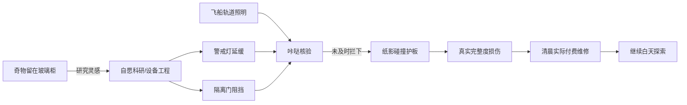

# V0.3 首星样板：自主安保、真实损伤与维修经济

2026-11-03，依据 [Review 5754645811](https://github.com/sy0310/loststar-game/pull/2#pullrequestreview-5754645811) 和用户本轮明确确认。已实现规则、真实引擎模拟与同屏可玩切片；仍是 [Draft PR #2](https://github.com/sy0310/loststar-game/pull/2)，不合并、不提审、不正式发行，不制作其他星球。

运行版本 **0.3.0 / 88e2e6b2b4506a4f016c9978c30d0a8c7c8f2b9d**。[单页规则/三方案比较](21_V03_RULES.md) · [实际审核页](../artifacts/v03/index.html)。

## 夜间由谁负责，奇物去了哪里

原远征继续240秒白天＋60秒夜晚。同一球体、机器人、绕轨飞船，原仓库/地形/居民/收藏室全部保留。正式设备ID为beacon/gate：警戒探照灯延缓纸影靠近，隔离门短暂停顿，咔哒核对封条，LR–01轨道照明；沿用此前100ms固定时间轴，效果真正改变拦截/抵站结果。只有一种纸影、三位访客、两个设备位，没有新的战斗页面、多波塔防或额外战斗货币。



奇物不再装备到安保槽、不会攻击或被研究消耗。基础两设备免费可用；高预算科研由已发现奇物解锁，研究参考藏品与观察记事身份一致。既有guard-0/1原键、原花费、原级数和上限保留，等值成为警戒灯/隔离门；换设备位时等级跟随设备。旧tape/bell枚举和数学函数仅为内部V0.2实验兼容，正常H5不包含独立实验入口，正式配置不接受奇物ID。

## 损伤与维修

- 基地完整度0–100。每位真正抵站的纸影造成最多6点实际剩余损伤，同源事件时刻即扣点，视觉有撞击、碎屑和护板裂纹。无损伤不付费；完整度2只扣2，不伪造6点。
- 夜间暂停维修。清晨/白天自动维修默认开，可关闭、手动维修；3零件/点，修复工位两级降为2/1。只扣真实修好的整点费用，余额7只修2点花6，剩1；不借债、无负余额。
- 自动维护限额为**累计实际赚取收入的30%**，未用限额最多结余300零件；没有预扣款，不是新货币。额度不足时继续有收入再补修；手动可按实际余额修复。关闭后不自动消费。不能靠反复刷新获得新额度。
- 未修时探索工作速度为80%＋完整度×0.2%，最低80%；不会停机，不丢永久奇物、居民图鉴、已购设备或旧余额。维修时同一机器人回到仓库焊接，裂纹渐退、完整度条回升，费用/点数可核对。
- 维修事务使用损伤版本、原保存锁与最新存档。旧标签重复提交、刷新、离线跨夜和写入失败不累计重复扣款。

### 离线保护

只对原货舱有效时长计算收入、损伤和可付维护，超过后继续世界时钟，但进入护站保护，不再积累损伤/账单。不是24小时每夜无限收费。原货舱基础2小时；四设备满级旧档7小时，工程扩展仍生效。

自动限额根据已赚收入累计，可携带最多300未使用额度，**不是每次打开重新发一份30%预算**。有效离线的毛收入/已付维修/净归航分别列出；领取只入净额，不再收费。时间倒拨不回滚，重复恢复不重复结算。

[24小时离线测试截图](../artifacts/v03/offline-24h-TEST-CLOCK-390.png)：从已探索228秒的样本继续离线，2小时有效毛收入4320、维修432、净3888；另264夜受保护，原余额284保留。截图是明确加速测试时钟，不是24小时真机挂机。

## 零件只有三类用途

| 类别 | 实际用途与反馈 | 价格/边界 |
|---|---|---|
| 设施维修 | 恢复真实损伤、探索效率、焊接和护板 | 3→2→1/点；不受损不扣 |
| 永久工程 | 原四设备/展柜/生态/设施/装饰、两安保设备、修复工位 | 固定有限等级，旧价保留；仅新增一条有两级的修复工位360/960 |
| 自愿定向调查/科研 | 临时真实探索与地表采样加速；完成带回下一份本地分类发现，已全收录则留下具体藏品/现场观察记事 | 90/5分钟/+10%；1200/15分钟/+25%；4800/30分钟/+40%；一次付费，不自动续费 |

科研不消耗藏品；高档需已发现奇物。计划实际改变引擎工作量/采样，不只是文案。观察按奇物、生物、事件分类，最近12份保留；费用不随次数无限上涨。当前没有大规模研究树/新星资源；重复研究的长期吸引力仍需试玩评估。

安保够强时当前三位纸影可全拦截，维修可为0。修复工位与安保升级是不同的可选回本路径，不要求所有工程买满。高余额继续积累也允许，不能以“花到零”为平衡目标。

## 真实引擎经济表

[可读表](../artifacts/v03/economy.md) · [全部CSV](../artifacts/v03/economy.csv) · [原始JSON](../artifacts/v03/economy.json)。72组：余额120/5000/27049/50000 × 无损/轻损/重损 × 自动开关 × 积累/建设/科研，0/15/30/60/120分钟；8/24小时从初始档独立离线试验，按实际货舱封顶。另有27049余额但四设备均0级的压力档。

每5秒调用正式引擎，内部按真实收入事件、碰撞、清晨、计划到期顺序结算。模拟每15秒一次自愿购买/续计划，不是游戏后台自动买单。安保满级组是“已有设备”的能力对照快照，原有资产不算本段新支出；建设策略按真实费用逐笔购买。计划离线最多执行已付的一单，不续费。

首小时的代表结果（均基础两安保设备、自动维修开）：

| 初始/策略 | 毛收入 | 维修 | 新工程 | 科研 | 净变动 | 剩余 |
|---|---:|---:|---:|---:|---:|---:|
| 新手120，积累 | 2160 | 216 | 0 | 0 | +1944 | 2064 |
| 新手120，建设 | 8731 | 186 | 8416 | 0 | +129 | 249 |
| 新手120，科研 | 2354 | 216 | 0 | 1080 | +1058 | 1178 |
| 旧档27049，积累 | 12132 | 216 | 0 | 0 | +11916 | 38965 |
| 旧档27049，建设 | 12132 | 0 | 27560 | 0 | −15428 | 11621 |
| 旧档27049，科研 | 16942 | 216 | 0 | 9600 | +7126 | 34175 |

旧档建设净减少是**主动购入永久工程27560**，不是维护持续亏损；维修为0是已建成安保有效。高预算科研会增加调查工作与观察，同时花掉9600，仍可保留大额余额。全矩阵无负余额样本、无维护超过累计收入30%、纯积累第一小时全部正收益；8/24小时受封顶保护后费用、完整度、净收入相同。

## 实际运行视频与界面

- [完整86秒黄昏/夜防/撞击/清晨维修](../artifacts/v03/security-night-damage-repair-86s.mp4)、[24秒关键段](../artifacts/v03/impact-dawn-repair-24s.mp4)、[14秒同源近景](../artifacts/v03/security-repair-closeup-14s.mp4)。开始前仅用引擎快照定位至第228秒；之后**全部真实墙钟**。清晨真实发现了一件邮戳，录屏用原生触控关闭提示再看维修，不用DOM删除遮挡。
- [低余额手动部分维修](../artifacts/v03/manual-partial-repair-live.mp4)：明确测试快照完整度82/余额7，真实触控修2点/花6/余1。
- [27049旧档迁移与一次4800科研](../artifacts/v03/legacy-research-investment-live.mp4)：明确旧档测试快照，原守护等级2/3原值转换，收藏不动；过程中正常收入继续，所以末尾余额高于27049−4800。
- [维修界面](../artifacts/v03/repair-interface-390.png)、[清晨明细](../artifacts/v03/morning-receipt-390.png)、[科研完成观察](../artifacts/v03/research-completed-TEST-CLOCK-390.png)。后者使用加速测试时钟，未声称真实录了30分钟。

所有视频/PNG为实际生产构建390×844桌面移动触控仿真，**不是TapTap真机截图/录像**。完整源码、正式资产与可复现脚本已提交；设施使用既有原创equipment/sorter纹理，独立光束/闸栏/裂纹/撞击/焊接由Canvas实现，没有拿设计参考拼版投产。

## 验证、资源与边界

- 20/20真实设计原件；**82项单元、104项浏览器流程**。360×800、390×844、1440×1000 Chromium，390×844 WebKit及二者原生触控仿真。覆盖抵站才损伤、清晨维修/部分修/0完整度、自动开关、设备等级随设备、27,049旧档、计划实际生效/不续费、在线/离线一致、长离线封顶、多标签、存储失败、重复恢复与领取、原雷达无剧透/收藏互动/基地/升级。
- 覆盖范围为游戏模型、夜守模型、基础路径/布局：行100%、语句96.38%、分支93.79%、函数97.40%，不是全部Canvas/UI或手机认证。
- 源码 [PR CI](https://github.com/sy0310/loststar-game/actions/runs/41669271986) / [push CI](https://github.com/sy0310/loststar-game/actions/runs/41669257584) 均success。[录制与性能原始JSON](../artifacts/v03/recordings.json)、[验证摘要](../artifacts/v03/validation.json)。
- Apple M2 Pro、生产构建、串行独立6秒窗口：Chromium361个rAF样本P95约16.8ms、WebKit360样本P95约19ms；JS绘制提交平均约0.185/0.331ms。编码30fps不是手机实测帧率。保留早期窗口在recordings-initial.json，不以P95推断所有时刻稳定60fps。
- 40张WebP，全部纹理RGBA尺寸推算19,243,264字节（约18.35MiB），不是实测GPU内存。概念图/审核录屏不进H5。静态包大小见下文。

复现：

```bash
npm ci
npm run check
npm run simulate:v03
npm run build
npm run preview -- --port 4173
node scripts/capture_v03.mjs --rehearse
npm run capture:v03
python3 scripts/package_taptap.py
```

## 开发自测与待审核

**428060 / v0.3.0 / Git 88e2e6b2b4506a4f016c9978c30d0a8c7c8f2b9d / H5 package153341**。43文件，ZIP2,236,394字节，解包2,348,320字节。SHA256 `0ed0a117085d7ece58d8d73cca05011675dd053d7ca146cdd48a2082f2b1154e`。正式相对路径包在Chromium/WebKit嵌套目录实际加载，无JS/HTTP错误。上传回执未绑定主包、列表未正式发行，私有二维码仅在会话提供。

待手机实测安保辨识、裂纹/焊接、自动开关/后台恢复和长时性能；本机未连接可调试手机。旧档若安保已满级，可能无损而不收费，可在白天停用一个设施对照，原设备等级不丢失。当前三位纸影是固定首版模型；长期科研内容、预算吸引力和节奏需要用户审核后再迭代，暂不扩张星球。
