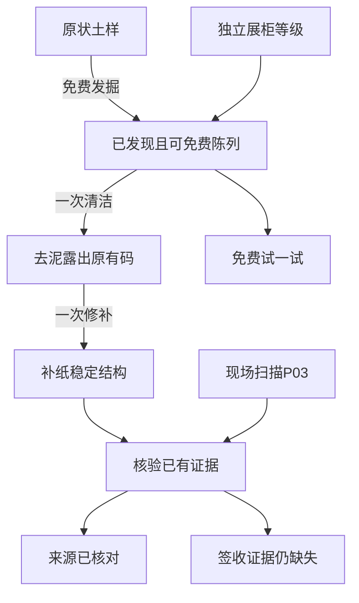

# V0.3.4 首周设计审核包

## 状态与计划

本包对应2026年11月4日至10日首周计划，依据 [首周计划](24_V034_WEEK1_DESIGN_FREEZE_PLAN.md) 与 PR #2 的 issuecomment-6620147122。提交物为设计候选、隔离运行样板和验证记录，主观视觉及最终数值由用户逐项审核后登记。11月10日进行冻结决策，保留未通过条目的问题和修订方式。

| 日期 | 工作目标 | 本包产物 | 审核门槛 |
| --- | --- | --- | --- |
| 11月4日 D1 | 现状走查、四系统边界 | 本文的范围、状态流、问题单 | 分清正式游戏、旧D1和本周候选 |
| 11月5日 D2 | 收据出土、清洁、修补、辨识 | 同物同镜头S0/S1/S2、交互和证据流 | 泥层真实去除、补痕保留、缺失记录有依据 |
| 11月6日 D3 | 球面事件和灯光、紧凑主界面 | 30秒事件、清晨维修、完整昼夜预览 | 路线、前后遮挡、飞船与设施参与可观察 |
| 11月7日 D4 | 居民日常、异常形态标准 | 三居民15秒、三异常标准表 | 有停顿和身体小动作，保留原足点 |
| 11月8日 D5 | 整理与三种系统抽屉 | 390/360交互稿、目的/成本/效果说明 | 主屏完整球体，主要操作可见且可触 |
| 11月9日 D6 | 经济、旧档与离线 | 192组候选模拟、迁移规范、回归证据 | 27049余额权益完整、维修和领取幂等 |
| 11月10日 D7 | 汇总审阅与冻结决策 | 本包、素材清单、问题单和实施拆分 | 用户已通过的条目才登记定稿 |

### 已有正式逻辑与本轮隔离范围

| 系统 | 正式游戏现状 | 本轮候选 |
| --- | --- | --- |
| 收藏与展柜 | 六件永久收藏、免费基础柜、case-i旧等级 | 同一收据的原状土样、污损、补纸分层和一次性整理 |
| 内容辨识 | 旧D1使用A/B内置回执 | 原件字码与实际样板现场P03扫描交叉核验 |
| 夜间与维修 | 240/60世界时钟、完整度、真实维修和离线封顶 | 同球体现场处置与真实账目的视觉候选 |
| 居民 | 已有昼夜姿势、少量飞行帧 | 停步嗅纸、啃食、抖壳、探头、落杆梳理 |
| 零件 | 既有有限工程、维修和调查任务 | 清理/修补候选、调查预算重算和真实输出说明 |

候选入口使用独立内存状态，所有正式存档键、资金和偏好通过Storage访问哨兵验证。正式游戏继续使用原来的生命周期和权益。将来通过视觉审核后再进行条件字段迁移和同源事件接入。

## 一件旧物的四个维度

物品状态、证据、展柜等级和消费账本分开存放。原件始终为RET-031，箱标P03，签收栏空白。清理只减少原件上方独立泥层，修补只增加透明纸背和纤维接缝，印字只在原来存活的纸面alpha内出现。补纸区域保留缺字。

| 画面 | 原件和分层 | 单一主操作 | 可见结果 |
| --- | --- | --- | --- |
| 原状土样 | 带回土样、真实前土层遮挡、脏破纸 | 免费发掘 | 4.5秒剥离，纸落回同一托盘锚点 |
| S0 | 同一破纸、泥膜、缺角 | 清洁40零件 | 3.4秒刷去泥膜，露出原来存在的字码 |
| S1 | 清洁破纸，原缺口仍在 | 修补120零件 | 3.6秒托住、压贴补纸，补痕可辨 |
| S2 | 同一纸体、补纸和缺字 | 前往现场核对P03 | 导向可实际扫描的首星现场 |
| S3 | 原件与场景观察对照 | 免费辨识已有线索 | 2.6秒核验，来源确认，签收仍待证 |

整理罩内保留原状土样用于观察出土过程。样板预算显式为360零件，清洁与修补后剩200，重复操作被状态与actionId双重防护。试一试仅舒卷与响应，可重复且免费。

### 证据可追溯

1. 原始字码始终在纸层内，污渍移除前后相同。
2. 咔哒在实际夜间场景扫描P03标牌，发生marker-scan事件后才产生field-pipe-scan。
3. 观察包含固定actionId、原件码、箱码、位置、事件类别和现场时刻。重播与换配置沿用同一actionId，收录去重。
4. 仓库接收只能证明运输和到站。原件签收空白，费用、清洁和修补均不能补齐签收事实。
5. 辨识开始时冻结输入证据，过程中新增的观察留待下一次核验，保证文字与当次演出一致。

P03标牌是本样板新增的首星现场内容，原PNG参考中没有该标牌。它在样板中可见、可扫描并留下来源，本周记录保持在内存，正式接入需要通过后续内容与存档审核。

### 另外五件奇物的个性差异

| 奇物 | 清洁候选 | 修补候选 | 一次性可见操作 |
| --- | --- | --- | --- |
| 自动道歉的胶带 | 20 | 80 | 轻剥纸屑，理顺卷边，保留旧胶印 |
| 无限套娃包裹 | 50 | 180 | 刷去箱缝灰，校正卡住的盖轴，恢复开合 |
| 昨天邮戳 | 60 | 160 | 擦去锈点，润滑并校准印面，保留年月磨损 |
| 收件人宇宙 | 40 | 220 | 去尘与封签加固，秘密仍封存 |
| 无人签收铃 | 30 | 140 | 清灰、调正铃舌，试响形成可见声波 |

表内仅定义设计差异和模拟费用，首周先审核收据的制作标准。每件都可先收藏，清理和修补永久完成，基础陈列和试用免费。

## 同球面夜间事件

| 实时片段 | 可观察动作 | 同源依据 |
| --- | --- | --- |
| 0–5秒 | 纸影从箱堆滑出，警戒点亮 | 旧夜间模型第三位访客出现 |
| 5–10秒 | 咔哒跨区域追踪，飞船前轨照明 | 原球面路线、真实轨道与设备引导区 |
| 10–16秒 | 扫描纸影与P03标牌，核对来源 | 同一访客核验进度和现场扫描事件 |
| 16–23秒 | 灯束引导、隔离门动作、收容准备 | 真实slowed/stunned与verification |
| 23–27秒 | 基础配置漏到仓库或完善配置封匣 | 实际arrival或intercept事件 |
| 27–30秒 | 携匣或空匣返回，原门洞接收 | 与处置结果相符的持物和门洞遮挡 |
| 30–36秒 | 清晨焊补或保持完好 | 真实完整度与维修回执 |

30秒为第三次处置片段，真实墙钟运行。模型选取同一次60秒夜班的40.2至60秒窗口，以连续时间映射供观察，前两位访客已由同一模型处理。另行提供正常240/60完整昼夜预览，媒体标记时间映射和环境。

两配置均为探照灯与隔离门。基础Lv0/Lv0的第三位访客实际抵站，损伤6点，每点3零件，自动修复18零件。完善Lv3/Lv3可在抵站前完成核验，本次损伤和维修费用均为0。对照只改变已声明的设备能力，原件留在收藏室。

### 异常的视觉标准

| 异常 | 识别特征 | 动作和灯光 | 接触与结果 |
| --- | --- | --- | --- |
| 漂行纸影 | 空心折翼、无居民面部特征、冷色纸边 | 翼片折叠、贴地滑行、跟踪光 | 暖色核验标记、透明收容匣与原门交接 |
| 弹跳空箱 | 空盖、外翻封条、无寄居蟹肢体 | 2–4帧压缩回弹、落点纸屑 | 隔离门落下，漏网时站点火花 |
| 环灯纸蛾 | 小型纸羽双翼、邮签翅纹 | 两帧扑翼、灯侧不规则短轨迹 | 警戒灯闪动，飞船定点照明后离灯 |

主事件先完整验证漂行纸影，其余两类用于形态和动作标准审核。异常同屏上限2–3，居民活动区和异常轨迹有间距。

## 居民生活与素材标准

| 居民 | 15秒白天观察 | 夜间 | 图层与注册 |
| --- | --- | --- | --- |
| 拆封鼠 | 两三步、停嗅、啃纸、抖耳、搬纸 | 抱纸睡、轻耳动 | 原脚点、真实头耳动作帧、地面投影 |
| 箱寄居蟹 | 侧移、停下抖壳、探头、拖纸、休息 | 收足、壳内警戒 | 壳体、肢体和影子共用足点 |
| 标签鸟 | 真扑翼、落杆、低头梳理、再次飞起 | 收翼栖息 | 复用已验飞行帧，新增落杆小动作 |

两帧小动作与插值、停顿组合。图像局部动作须在实际390画面中可辨，数据状态变化只作辅助核验。新的生活动作通过review专用绘制hook，正式居民保持现有行为到视觉确认。

素材审核保存原PNG、提示词、alpha边界、接触点、运行时尺寸和确定性导出。主线程先看原图，再看256纹理/67逻辑像素合成，最后看实际连续动画。泥膜出现杂色边与颗粒质感不协调时已退回重制，合成实图通过后才录正式媒体。

## 同一套底部抽屉

主画面保留完整球体。顶部仅显示地点、时段、预算和完整度，中间一条现场状态，下方三个入口安保、科研、维修，底部导航在独立区域。

| 抽屉 | 可读信息 | 本周真实可操作范围 |
| --- | --- | --- |
| 奇物整理 | 物理状态、原码、缺失信息、下一操作 | 免费发掘/试验、一次清洁/修补、现有证据核验 |
| 安保 | 两设施、当前能力、基础与完善差异 | 换本样板配置并重播，实际结果可对照 |
| 科研 | 目标、费用、时长、已有来源、实际输出 | 浏览候选预算，前往实际P03现场核对 |
| 维修 | 完整度、真实损伤点、单价、实际支出 | 自动开关、部分维修条件及晨间结果对照 |

展示升级从收藏区域独立进入。整理台主按钮随状态改变，免费试一试保持可见。抽屉支持明确关闭、返回焦点、键盘Escape和手机安全区。主按钮至少44px，360×800/390×844不遮住物品。

## 零件的四类用途与候选数值

| 用途 | 候选预算 | 可验证价值 | 保护 |
| --- | --- | --- | --- |
| 奇物清洁与修补 | 20–60与80–220一次 | 原泥层移除、真实补纸和结构恢复 | 永久完成，旧藏品免补交 |
| 设施维修 | 沿用每点3→2→1 | 恢复真实损伤、恢复相应探索效率 | 自动维修受有效收入30%预算保护 |
| 基地建设 | 沿用已有有限工程价格 | 灯、门、离线承载、修复工位、展柜 | 原等级/权益保留，已满级不重复购买 |
| 现场调查与科研 | 180/900/2400 | 真实5/15/30分钟期间10/25/40%探索与地表采样增效 | 自愿单次，离线不自动续费 |

研究完成记录实际探索次数、采样次数和已发现首星记录。首星12份发现已齐时显示“复核与增效”，不能暗示花费后必定生成新奇物或新星球。签收缺失只能由将来可获得的真实签收内容解决。

[完整经济候选表](../artifacts/v034/economy.md) 覆盖192组、1344行。收入、真实夜损、维修和离线调用原引擎。新增整理账本和科研候选调价只用于隔离预测。余额120/5000/27049/50000，新档/全部旧权益，低/中/高初始安保暴露，自动开关与四种策略。在线15秒步进，列出0/15/30/60/120分钟，8/24小时离线重新起算并按真实货舱截断。

完整旧权益货舱为570分钟，因此8小时与24小时可以不同，24小时仍只按570分钟有效收入计入损伤和维修。输出同时显示实际可研究的记录数、尚未发现数、资源不足次数和重扣次数。

## 迁移规范候选

1. 继续原SAVE_KEY和version2读取，保留资金、待领取净归航、收藏、已发现星图、设备、展柜、安保和维修权益。
2. 拟增加的artifactCondition字段按物品ID扩展。旧档已拥有的奇物默认为stabilized，历史展示等级原样；后续新发现才按found建立条件。
3. 已有旧D1 A/B回执或研究级均不迁入正式证据。正式evidenceIds需要可验证来源事件和去重actionId，观察历史与已辨识输入分别保留。
4. 清洁/修补事务包含物品、预期旧状态和唯一操作ID。写入失败保留当前内存并沿用现有提交锁，恢复时根据已完成状态核对，保证旧标签与重试无法再次消费。
5. 离线仍使用有效货舱时长。维修按收入预算与真实损伤结算，科研只完成已资助的一单，清洁修补不在后台自动开始。
6. 正式接入时补齐存储失败、竞争标签、倒拨时钟、旧版本、离线跨夜和重复领取测试，再更新存档迁移版本说明。

## 待审核问题与实施门槛

| 项目 | 当前状态 | 责任与下一步 |
| --- | --- | --- |
| 同一物品的S0/S1/S2、真实工具接触 | 待视觉审核 | 主线程逐帧复审与用户扫码 |
| 球面夜巡、基础/完善损伤及焊补 | 待视觉审核 | 主线程核对模型和画面，用户评价游戏感 |
| 居民日常及阴影/尺寸 | 待视觉审核 | 主线程看15秒实录，用户评价自然度 |
| 三抽屉与整理台 | 待交互审核 | 360/390触控仿真后提供真机 |
| 192组候选数值 | 自动核对已通过，数值待审 | 根据真实试玩节奏决定最终价格 |
| 正式条件与证据迁移 | 设计候选 | 用户通过视觉后再实施 |
| 真机、锁屏、低端WebView、发热 | 待实测 | TapTap新版本扫码反馈 |

通过审核后，按收据条件与证据、夜间视觉接入、居民、抽屉、其余奇物五个独立任务实施，每个任务保留真实媒体和旧档回归。后续星球仍等待首星质量审核。
