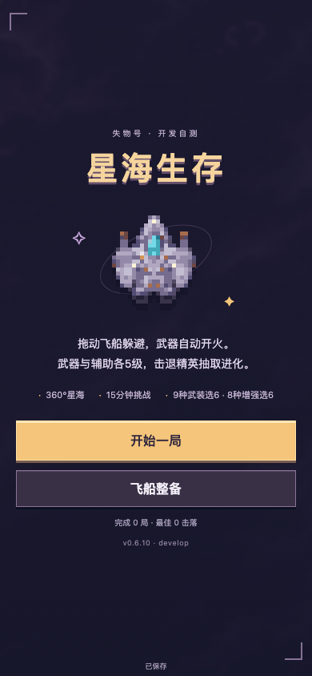
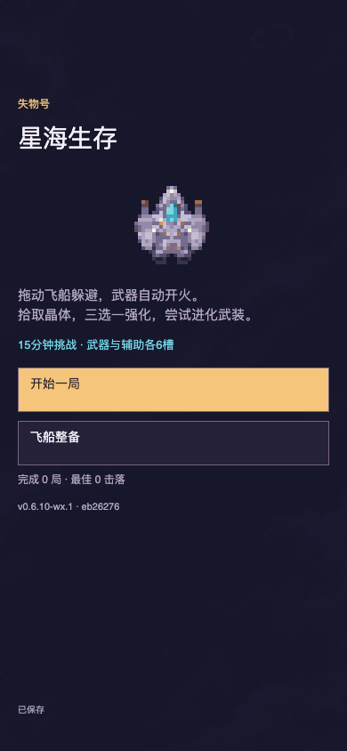
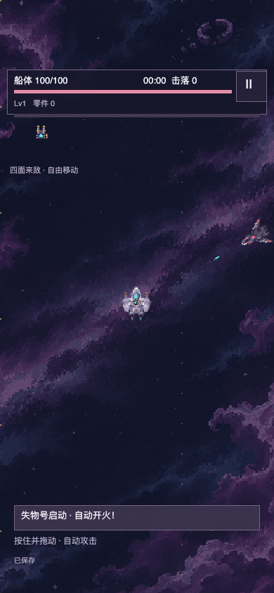
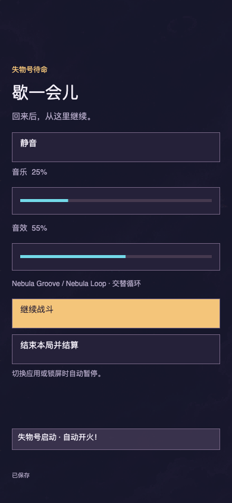

# 微信小游戏开发版 0.6.10.1

2026-11-14，用户明确选择《失物号·星海生存》v0.6.10。微信开发者工具完成已有目录导入并显示“代码上传成功”。上传使用开发者工具当前登录态。

| 项目 | 实际值 |
| --- | --- |
| AppID | `wx69a4de5574460d86` |
| 微信上传版本号 | `0.6.10.1` |
| 游戏内部构建号 | `0.6.10-wx.1` |
| 冻结运行源码 | `eb262765c1104d47938dca1e82d135c5d384d4d0` |
| 导入目录 | 仓库下的 `releases/wechat-minigame` |
| 开发者工具 | Stable `2.02.2608080` |
| 基础库 | `3.18.0` |
| 导出文件清单 | 125文件，逐文件大小与SHA256复核 |
| 主包文件原始字节 | 1,004,145 |
| 全部文件原始字节 | 5,628,323 |
| 平台回执 | 开发者工具UI显示“代码上传成功” |

构建元数据 `build-info.json` 由 packOptions.ignore 排除上传。开发者工具成功提示同时显示此排除项。当前回执依据工具UI，后台版本列表尚待核实。[构建文件清单](../artifacts/wechat-v0610/build-info.json) · [上传观察记录](../artifacts/wechat-v0610/upload.json)

## 实现范围

- 新增微信平台绑定、Canvas菜单/HUD、触控与拖动滚动、音频适配、构建导出和专用回归。游戏通过现有控制器的文字、费用、按钮回调与真实状态运行。[微信实现目录](../prototypes/salvage-survivor-demo/wechat/README.md)
- 现有存储模块增加可选原生事务后端。微信账本包含修订号、回执、随机种子与在途快照，整份一次写入。贯穿弹的Set命中集合显式编码。失败会保留上一份账本并提供重试。
- 74张PNG继续使用现有运行素材。两首已批准MP3各有独立按需分包。原合成器离线导出22种音效及其进化版本，共44个小音频文件。
- 微信键为 `loststar.survivor.demo.v06.wechat.v1`。各微信设备本地保存进度，浏览器IndexedDB继续各自保存。当前跨平台存档导入功能待开发。

## 验证

| 验证范围 | 当前结果 |
| --- | --- |
| 原始概念资源 | `validate_design_assets.py` 20/20 |
| 原战斗模型 | 原118组通过 |
| 原H5存储 | Chromium/WebKit × 360×800/390×844，60项通过，0跳过/重试/失败 |
| 微信导出入口 | 两竖屏实际控制器与微信回调适配器通过 |
| 选卡 | 隔离存档夹具进入真实升级，三选一、刷新次数持久化与实际选中通过 |
| 本地存储 | 续局、结算、重复归档、写入失败重试和坏档保留通过 |
| 图形兼容 | Chromium/WebKit × 两竖屏，74素材加载、菜单滚动、开局、后台暂停与刷新续局均通过，页面异常0 |
| 微信开发者工具 | 实际首页、开局和战绩归档可见，运行面板0错误 |
| 构建 | 微信冻结导出、原84文件H5构建、JS语法和diff检查通过 |

图形检查截图来自桌面浏览器中的微信API兼容测试环境，覆盖相同导出入口。微信开发者工具的实际运行另通过原生UI观察，首屏、战斗和持久归档均已检查。[图形兼容记录](../artifacts/wechat-v0610/browser.json) · [H5存储报告](../artifacts/wechat-v0610/h5-storage.json)

### 390×844图形对照

| 原H5首页 | 微信Canvas首页 |
| --- | --- |
|  |  |

| 微信Canvas战斗 | 微信Canvas暂停 |
| --- | --- |
|  |  |

## 后续待办

- 管理员在微信后台版本管理中核实 `0.6.10.1`，设置体验版并安排手机验收。公众平台网页被浏览器站点安全策略拦截，本次后台体验版状态尚待核实。
- 核对微信后台账号资料、游戏类目、资质和平台要求的审核材料，再推进审核与上架。当前这些字段的具体完成状态待后台读取。
- 真机验收包含微信触控与刘海区域、实际锁屏续局、分包首次/弱网加载、声音听感、发热、耗电和长时游玩。
- Canvas界面目前处于用户验收阶段。浏览器与微信设备的跨平台存档导入功能待开发。

本轮源码和证据继续位于 Draft PR #2。[审核入口](https://github.com/sy0310/loststar-game/pull/2)
