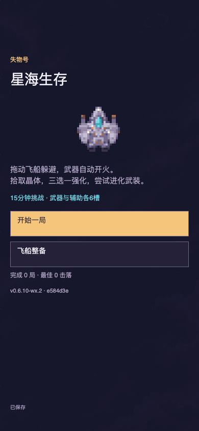
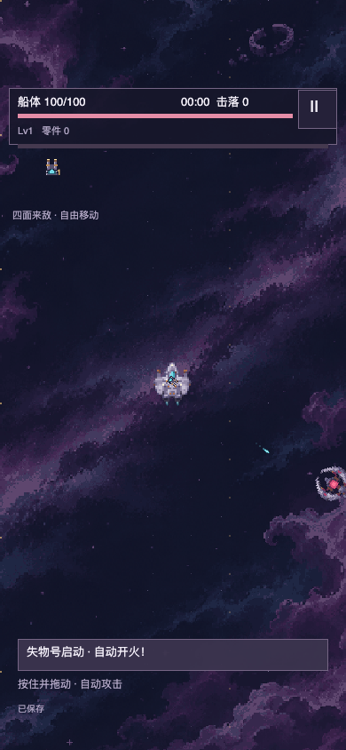

# 微信审核返修

2026-11-15，审核设备小米11、HyperOS 2.0.2.0、微信8.0.78。截图底部显示`无法加载素材 ./assets/actors/player@2x.png`，同时“开始一局”处于禁用状态。图片加载异常使`initialize()`提前失败，`ready`保持false，首页因此不能开局。

截图能够确认素材加载失败。相对路径解析、打包裁剪或解码拒绝中的具体设备原因仍需小米11复测确认。本轮按代码包根目录路径导出图片，明确保留动态资源，并覆盖失败后的恢复流程。

## 修复范围

- 微信图集路径从`./assets/...@2x.png`变为`assets/...-2x.png`，74张PNG与原始运行素材逐项字节和SHA256相等。
- assets目录显式纳入打包，项目与现有本地配置均关闭未使用文件过滤。打包清单125文件、主包981,651字节、总文件5,605,829字节已逐项核对。
- 初始化失败的操作显示“重新加载”，按钮完整位于触摸有效区域。模拟飞船图片失败后，实际点击该按钮可重新加载74张图片并开局。
- 按钮命中由`findLast`改成倒序循环，战斗波次的两处`at(-1)`改为兼容的末项读取。缺少这些API时的首次触摸异常已有失败回归记录。

## 构建与验证

冻结源码`e584d3edec98b28e92b4f66ceb64cb97de1db4e8`，内部适配版本`0.6.10-wx.2`，实际上传版本`0.6.10.3`。导入目录为`releases/wechat-minigame`。

| 检查 | 结果 |
| --- | --- |
| 战斗与旧规则模型 | 118组通过 |
| H5存储回归 | 60项通过，0跳过、重试或意外失败 |
| 原生入口 | 360×800、390×844通过，包含图片失败恢复、菜单、滚动、移动、选卡、暂停、续局、结算、保存失败重试 |
| 图形兼容 | Chromium/WebKit×两竖屏，共4组通过，74张图正常加载、页面异常0 |
| 受限环境 | 拒绝`./`图片路径，删除`Array.prototype.findLast`和`Array.prototype.at`后运行上述原生与图形检查 |
| 开发者工具 | 最终源码首页飞船及整备素材正常，用户亲手点击后确认已进入战斗 |
| 物理手机和平台审核 | 待重新验证 |

前版在缺少`findLast`的测试环境下首次触摸报错，在拒绝点相对路径的图片测试环境下出现与审核截图相同的素材错误。后者是能力受限的模拟加载器，具体手机路径行为待实机确认。失败记录、最终文件摘要与验证范围均保留。[触摸失败](../artifacts/wechat-v0610-wx2/before-touch-failure.txt) · [素材失败](../artifacts/wechat-v0610-wx2/before-image-failure.txt) · [机器清单](../artifacts/wechat-v0610-wx2/verification.json)

### 最终包的兼容测试画面

| 首页 | 战斗 |
| --- | --- |
|  |  |

截图来自桌面微信API兼容测试环境。开发者工具开局另由用户手动确认。自动化输入未触发该模拟器的触摸事件，未将这段自动化操作计为通过。

## 提交审核前

后台选最新的`0.6.10.3`。首页底部源码摘要应为`e584d3e`。需在实际手机确认飞船显示、开始一局、移动、后台暂停及重新进入，并等待平台复核。

开发者工具已返回“代码上传成功”，仅build-info.json因打包配置被排除。开发版的实际上传版本、源码和观察时间已记录。[上传回执](../artifacts/wechat-v0610-wx2/upload.json)

本轮继续在Draft PR #2中交付。
